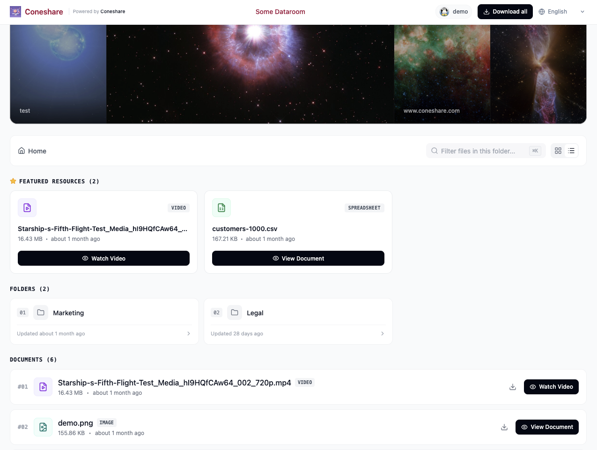
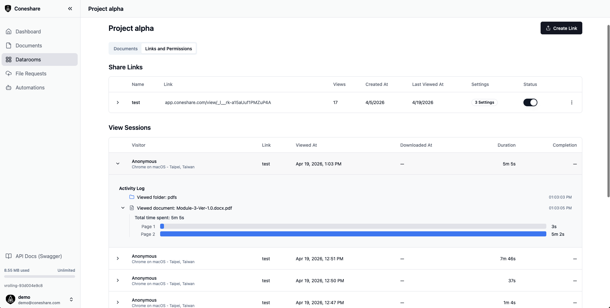
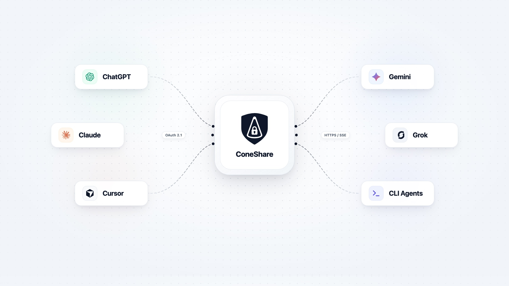
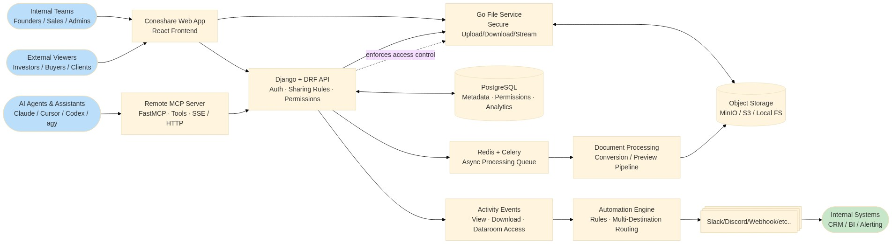

English | [中文](./README_zh.md)


[](https://github.com/coneshare/coneshare/actions/workflows/build-ci.yml)
[](https://deepwiki.com/coneshare/coneshare)
[](https://opensource.org/licenses/MIT)
[](https://docs.coneshare.com/en/)

# Coneshare

Coneshare is an open-source, self-hosted alternative to DocSend and Virtual Data Room (VDR) software. It has no per-seat pricing, and files stay on your own servers.

You can import files from Nextcloud, Google Drive, or Dropbox, or store them directly on local disk or S3-compatible storage such as MinIO. Coneshare adds virtual datarooms, dynamic watermarks, NDA gates, page-by-page engagement tracking, video streaming, and a remote MCP server for ChatGPT, Claude, Gemini, and Cursor.

[Quick start](https://github.com/coneshare/coneshare-compose) · [Live demo](https://www.coneshare.com/demo) · [Docs](https://docs.coneshare.com/en/) · [Setup & Managed BYOC](https://www.coneshare.com/pricing) · [Forum](https://github.com/orgs/coneshare/discussions)

If you find this project useful, please consider starring the repository.

### Product preview

| Branded Virtual Data Room (VDR) | Page-by-page engagement analytics |
| :---: | :---: |
|  |  |
| **Dynamic watermarks & secure preview** | **Remote MCP (ChatGPT / Claude / Gemini / Cursor)** |
|  |  |

<p align="center">
  <em>▶ <a href="https://assets.coneshare.com/coneshare-walkthrough-v1.mp4"><strong>Click here to watch the 2-minute product walkthrough video</strong></a></em>
</p>

---

## Comparison

| | Coneshare (MIT self-hosted) | DocSend (closed SaaS) | Papermark (cloud / free self-hosted) |
| :--- | :--- | :--- | :--- |
| **Virtual Data Rooms (VDR) in open source** | Included | Paid closed SaaS | Excluded from free self-hosted |
| **Dynamic watermarks and NDA gates** | Included (MIT) | High-tier plans only | Commercial or paid plans for full VDR |
| **Team seats and external viewers** | Unlimited | Per-seat (`$180/mo` + `$60/seat/mo`) | Per-seat on cloud |
| **Data residency and storage** | Your own servers | Third-party cloud | Cloud is third-party; self-hosted VDR needs a commercial license |

### How teams customize Coneshare

Teams and system integrators have forked the MIT codebase for compliance and diligence workflows:

- A solution partner in Saudi Arabia customized it for clinic document sharing and file collection under PDPL data residency rules.
- A carbon-credit team adapted it into an investor due diligence portal combining protected documents with external operational telemetry.
- Other forks adapt it for fundraising and M&A deal evaluation with NDA gates, watermarks, and page-level tracking.

---

## Deployment and managed hosting

The MIT Community Edition is free with unlimited seats and viewers. If you would rather not set up servers, SSL, SMTP, and video transcoding yourself, we offer three paid services. Smaller orders use PayPal or credit card; annual and B2B orders can use corporate wire transfer and a commercial invoice.

| Service | Price (USD) | Best for | What is included |
| :--- | :--- | :--- | :--- |
| **Done-For-You Setup** | `$299` one-time | Founders and small teams who want production setup fast | Deployment on your cloud or VPS in 1 to 2 business days, domain/SSL/SMTP, storage and watermark setup, one admin onboarding session, and a 14-day warranty |
| **Managed BYOC** | `$199 / mo` (3-mo min `$597`) or `$1,999 / yr` | Advisory firms, law firms, and B2B teams | Setup, security updates, backup checks, and 1-business-day email support (runs in your own cloud account) |
| **Support & Advisory** | `$150 / hour` | Self-hosting engineers and ISVs customizing Coneshare | Troubleshooting, performance tuning, architecture review, and upgrade guidance via email, Slack, or remote session |

See full pricing and cost comparisons at [coneshare.com/pricing](https://www.coneshare.com/pricing), or email [dev@coneshare.com](mailto:dev@coneshare.com?subject=Coneshare%20Setup%20%2F%20Hosting%20Inquiry).

---

## How it works

Coneshare runs on your own infrastructure:

- Import files from Nextcloud, Google Drive, or Dropbox, or upload directly to your own server storage (local disk or MinIO).
- Coneshare adds:
  - Virtual datarooms and media previews
  - Access controls and link permissions
  - Document engagement tracking
  - Webhooks and workflow automation

Keep your existing storage workflows while gaining access controls, datarooms, and engagement analytics.

---

## Features

### Virtual datarooms and media previews
- Organize documents and rich media into structured rooms.
- PDF rendering and secure video streaming.
- Inline viewers to navigate between related items.

### Access control
- Password protection, link expiration dates, and email verification.
- Download restrictions and dynamic watermarks.

### Analytics and engagement tracking
- Track views, revisits, and downloads in real time.
- View page-by-page reading duration and video playback metrics.

### Automation and webhooks
- Slack and webhook notifications for link events.
- Trigger actions based on viewer activity.

### Infrastructure, privacy, and internationalization
- Self-hosted on your own servers or private cloud.
- Available in English, Simplified Chinese, Russian, German, French, and Dutch (`en`, `zh-hans`, `ru`, `de`, `fr`, `nl`).

---

## AI agents and remote MCP

You can connect web AI assistants (ChatGPT, Gemini, Claude.ai, and Grok) and CLI or desktop coding agents (Claude Code, Claude Desktop, Cursor, VS Code, Codex, and Antigravity `agy`) to your Coneshare workspace over the remote Model Context Protocol (MCP) endpoint (`/mcp/sse`). The server provides MCP tools for saving AI conversations, organizing datarooms, creating protected or watermarked share links, and checking viewer engagement.

- Web AI clients sign in with OAuth 2.1 and PKCE (`read` or `write` scopes). Destructive deletes, admin routes, and viewer PII remain blocked.
- CLI and desktop agents authenticate with scoped API keys (`read_only`, `read_write`, or `full_access`).

See [`mcp-server/README.md`](./mcp-server/README.md) for setup steps, the walkthrough video, and the tool list, or check [Coneshare AI & MCP](https://www.coneshare.com/agents) and [MCP Docs](https://docs.coneshare.com/en/mcp-server/).

---

## Integrations

Coneshare connects with:

- Nextcloud (self-hosted)
- Google Drive
- Dropbox

More storage connectors are in development.

---

## Deployment (self-hosted)

For production deployments, use the [coneshare-compose repository](https://github.com/coneshare/coneshare-compose).

---

## Local development

To run the codebase locally for development and contributions:

### Source build

```bash
git clone git@github.com:coneshare/coneshare.git
cd coneshare
cp .env.template .env
make build
make up
make migrate
```

### First-run verification checklist

After `make up` and `make migrate`, verify the local services before configuring storage integrations:

- Frontend is reachable at [http://localhost:5173](http://localhost:5173)
- API responds at [http://localhost:8000/api/v1/](http://localhost:8000/api/v1/)
- Core services are up (`backend`, `frontend`, `core`, `redis`, `celery`)
- Local files persist under the project data and storage volumes defined in `docker-compose.yml`
- Smoke test:
  - Upload one document
  - Create a share link
  - Open the link in a private browser window to confirm view access works

### Troubleshooting first install

- `.env` and `SITE_DOMAIN` mismatch:
  - Confirm `.env` exists (copied from `.env.template`) and `SITE_DOMAIN` matches how you access the app locally.
- Backend cannot reach `core` service:
  - Check service names and ports in `docker-compose.yml`, then inspect backend and core logs for connection errors.
- Redis or Celery issues (background jobs not running):
  - Confirm both `redis` and `celery` containers are running, then check Celery worker logs.
- Storage permissions:
  - Verify mounted storage directories exist and are writable by container processes.
- Where to look first:
  - Run `make logs` from the repository root, checking `backend`, `core`, and `celery` error output.

---

## Architecture



Coneshare consists of four primary services:

* `backend/`: Django and DRF API, Celery, and Redis for background tasks
* `core/`: Go service for file delivery and media streaming
* `frontend/`: React and Vite web application
* `mcp-server/`: FastMCP remote server for AI agent and assistant integrations

Technical reference:

* [Technology Stack](docs/strategy/coneshare-techstack.md)
* [Open API Reference](docs/strategy/coneshare-open-api.md)

---

## Contributing

Contributions are welcome. Please read [CONTRIBUTING.md](CONTRIBUTING.md) for our code of conduct and pull request process.

## Contributors

<!-- ALL-CONTRIBUTORS-LIST:START - Do not remove or modify this section -->
<!-- prettier-ignore-start -->
<!-- markdownlint-disable -->
<table>
  <tbody>
    <tr>
      <td align="center" valign="top" width="14.28%"><a href="https://github.com/xiez"><br /><sub><b>Justin Zheng</b></sub></a><br /><a href="https://github.com/coneshare/coneshare/commits?author=xiez" title="Code">💻</a> <a href="https://github.com/coneshare/coneshare/commits?author=xiez" title="Infrastructure (Hosting, Build-Tools, etc)">🚇</a> <a href="https://github.com/coneshare/coneshare/commits?author=xiez" title="Documentation">📖</a> <a href="https://github.com/coneshare/coneshare/commits?author=xiez" title="Design">🎨</a></td>
      <td align="center" valign="top" width="14.28%"><a href="https://github.com/jamesramsay"><br /><sub><b>James Ramsay</b></sub></a><br /><a href="https://github.com/coneshare/coneshare/commits?author=jamesramsay" title="Code">💻</a> <a href="https://github.com/coneshare/coneshare/commits?author=jamesramsay" title="Tests">⚠️</a> <a href="https://github.com/coneshare/coneshare/issues?q=author%3Ajamesramsay" title="Bug reports">🐛</a></td>
      <td align="center" valign="top" width="14.28%"><a href="https://github.com/mfriedewald"><br /><sub><b>Matthias Friedewald</b></sub></a><br /><a href="https://github.com/coneshare/coneshare/commits?author=mfriedewald" title="Code">💻</a> <a href="https://github.com/coneshare/coneshare/commits?author=mfriedewald" title="Tests">⚠️</a> <a href="https://github.com/coneshare/coneshare/issues?q=author%3Amfriedewald" title="Bug reports">🐛</a></td>
      <td align="center" valign="top" width="14.28%"><a href="https://github.com/KeizerDev"><br /><sub><b>KeizerDev</b></sub></a><br /><a href="https://github.com/coneshare/coneshare/commits?author=KeizerDev" title="Code">💻</a> <a href="https://github.com/coneshare/coneshare/commits?author=KeizerDev" title="Translation">🌍</a> <a href="https://github.com/coneshare/coneshare/commits?author=KeizerDev" title="Tests">⚠️</a></td>
      <td align="center" valign="top" width="14.28%"><a href="https://github.com/tomelliot"><br /><sub><b>Tom Elliot</b></sub></a><br /><a href="https://github.com/coneshare/coneshare/commits?author=tomelliot" title="Code">💻</a> <a href="https://github.com/coneshare/coneshare/commits?author=tomelliot" title="Tests">⚠️</a> <a href="https://github.com/coneshare/coneshare/issues?q=author%3Atomelliot" title="Bug reports">🐛</a></td>
      <td align="center" valign="top" width="14.28%"><a href="https://github.com/pagatino-afk"><br /><sub><b>Agatino Platania</b></sub></a><br /><a href="https://github.com/coneshare/coneshare/commits?author=pagatino-afk" title="Code">💻</a> <a href="https://github.com/coneshare/coneshare/commits?author=pagatino-afk" title="Tests">⚠️</a> <a href="https://github.com/coneshare/coneshare/issues?q=author%3Apagatino-afk" title="Bug reports">🐛</a></td>
      <td align="center" valign="top" width="14.28%"><a href="https://github.com/Industry"><br /><sub><b>Industry</b></sub></a><br /><a href="https://github.com/coneshare/coneshare/commits?author=Industry" title="Code">💻</a> <a href="https://github.com/coneshare/coneshare/commits?author=Industry" title="Tests">⚠️</a> <a href="https://github.com/coneshare/coneshare/issues?q=author%3AIndustry" title="Bug reports">🐛</a></td>
    </tr>
    <tr>
      <td align="center" valign="top" width="14.28%"><a href="https://github.com/kta1kri"><br /><sub><b>kta1kri</b></sub></a><br /><a href="https://github.com/coneshare/coneshare/issues?q=author%3Akta1kri" title="Bug reports">🐛</a></td>
    </tr>
  </tbody>
</table>

<!-- markdownlint-restore -->
<!-- prettier-ignore-end -->

<!-- ALL-CONTRIBUTORS-LIST:END -->

---

## Community

* Docs: [https://docs.coneshare.com/en/](https://docs.coneshare.com/en/)
* Discussions: [https://github.com/orgs/coneshare/discussions](https://github.com/orgs/coneshare/discussions)
* Email: [dev@coneshare.com](mailto:dev@coneshare.com)

---

## License

MIT License. See [LICENSE](LICENSE).

---

## Security

For security issues, contact [dev@coneshare.com](mailto:dev@coneshare.com).
