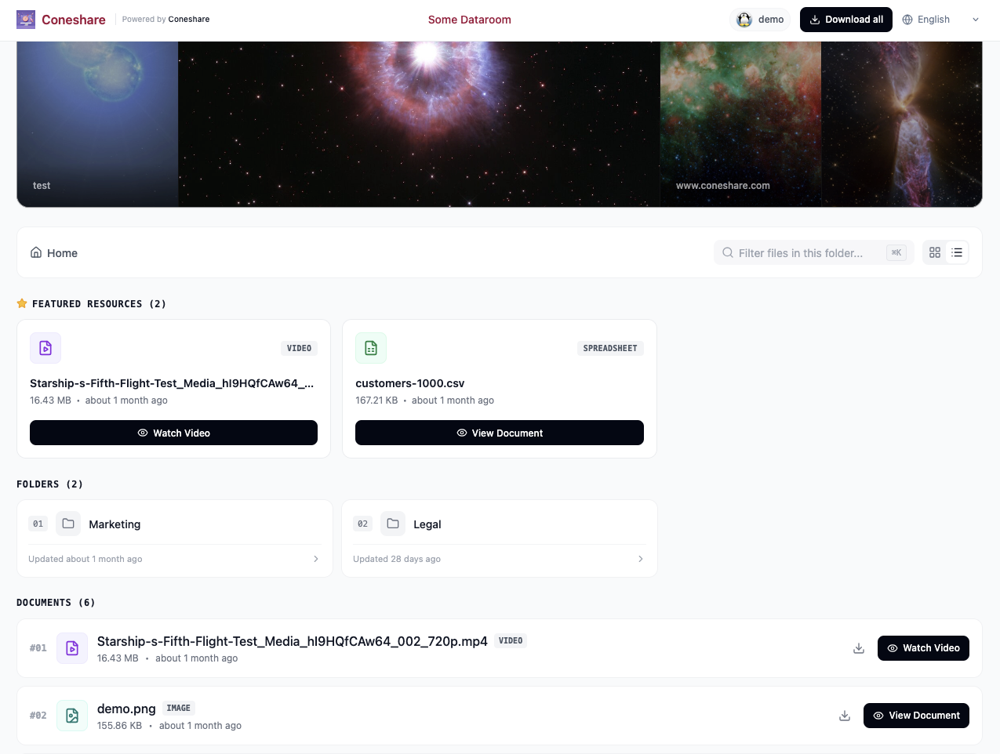
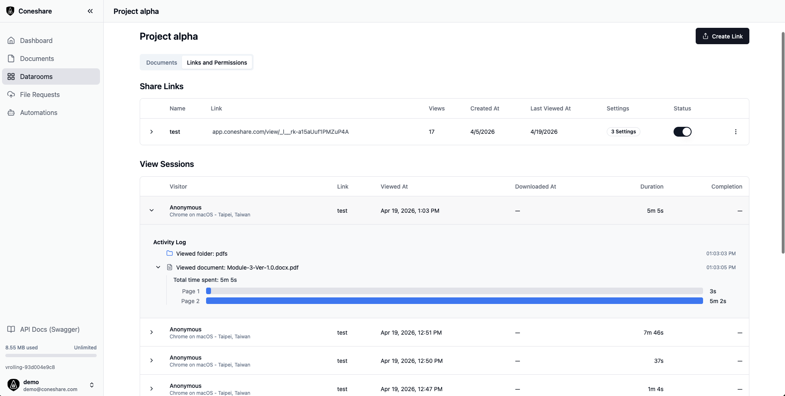
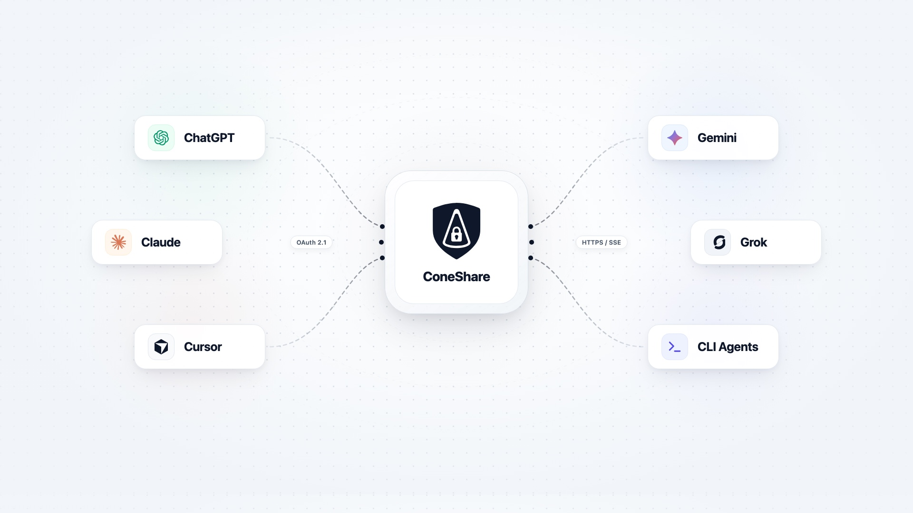
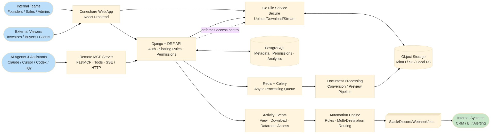

[English](./README.md) | 中文


[](https://github.com/coneshare/coneshare/actions/workflows/build-ci.yml)
[](https://deepwiki.com/coneshare/coneshare)
[](https://opensource.org/licenses/MIT)
[](https://docs.coneshare.com/en/)

# Coneshare

Coneshare 是开源、可自托管的 DocSend 替代品与虚拟数据室（Virtual Data Room），不按人头收费，文件留在您自己的服务器上。

支持从 Nextcloud、Google Drive、Dropbox 导入文件，或直接存储在本地磁盘与 MinIO 等对象存储中。在此基础上提供虚拟资料室、动态水印、NDA 签署门禁、逐页阅读时长统计、视频流预览，以及面向 ChatGPT、Claude、Gemini 和 Cursor 的远程 MCP 服务。

[快速部署](https://github.com/coneshare/coneshare-compose) · [在线演示 Demo](https://www.coneshare.com/zh/demo) · [文档 (EN)](https://docs.coneshare.com/en/) · [部署与托管服务](https://www.coneshare.com/zh/pricing) · [讨论区](https://github.com/orgs/coneshare/discussions)

如果这个项目对您有帮助，欢迎给仓库点个 Star。

### 产品预览

| 品牌化虚拟资料室（VDR） | 逐页阅读时长与访客分析 |
| :---: | :---: |
|  |  |
| **动态水印与安全预览** | **远程 MCP（ChatGPT / Claude / Gemini / Cursor）** |
|  |  |

<p align="center">
  <em>▶ <a href="https://assets.coneshare.com/coneshare-walkthrough-v1.mp4"><strong>点击观看 2 分钟产品演示视频</strong></a></em>
</p>

---

## 方案对比

| | Coneshare（MIT 开源自建） | DocSend（闭源 SaaS） | Papermark（云版 / 免费自托管版） |
| :--- | :--- | :--- | :--- |
| **开源版包含虚拟资料室（VDR）** | 包含 | 闭源付费 | 免费自托管版不含 Data Rooms |
| **动态水印与 NDA 门禁** | 包含（MIT） | 仅高阶套餐 | 商业用途或完整 VDR 需付费授权 |
| **团队席位与外部访客** | 不限人数 | 按席位收费（`$180/月` 起 + `$60/人/月`） | 云版按席位收费 |
| **数据主权与存储位置** | 自有服务器 | 第三方云端 | 云版为第三方托管；商用自建 VDR 需购买授权 |

### 社区定制案例

已有开发团队与系统集成商基于 Coneshare 的 MIT 开源代码进行二次开发：

- 沙特的一家方案商基于它做白标定制，用于当地医疗诊所的文档协作与文件收集，满足 PDPL 数据本地化要求。
- 一家碳信用团队将其改造为投资人尽调门户，把受控文档与外部实时遥测页面结合在一起。
- 也有分支用于投融资与并购交易评估，加入 NDA 门禁、水印和逐页访问追踪。

---

## 部署与托管服务

MIT 开源版免费使用，不限制成员和访客数。如果不想自己折腾服务器、SSL、SMTP 和视频转码，我们也提供三项付费服务。小额支持 PayPal 或信用卡支付，年付和大额对公订单支持银行电汇与正式商业发票。

| 服务 | 价格（USD） | 适用对象 | 包含内容 |
| :--- | :--- | :--- | :--- |
| **Done-For-You Setup** | `$299` 一次性 | 想快速上线的创始人与小团队 | 1 到 2 个工作日内完成云主机或 VPS 部署、域名与 SSL/SMTP 配置、存储与水印调优、1 次管理员培训，以及 14 天排障保障 |
| **Managed BYOC** | `$199 / 月`（3 个月起 `$597`）或 `$1,999 / 年` | 咨询、律所及 B2B 团队 | 部署在您自己的云账号内，包含安全更新、备份检查与 1 个工作日内邮件技术支持 |
| **Support & Advisory** | `$150 / 小时` | 正在自建或二开的工程团队与集成商 | 通过邮件、Slack 或远程会议提供排障、性能调优、架构审查与升级指导 |

完整方案与成本对比见 [coneshare.com/zh/pricing](https://www.coneshare.com/zh/pricing)，也可直接发邮件至 [dev@coneshare.com](mailto:dev@coneshare.com?subject=Coneshare%20Setup%20%2F%20Hosting%20Inquiry)。

---

## 工作原理

Coneshare 运行在您自己的基础设施之上：

- 支持从 Nextcloud、Google Drive 或 Dropbox 导入文件，或直接上传至自有服务器存储（本地磁盘 / MinIO）。
- Coneshare 提供：
  - 虚拟资料室与多媒体预览
  - 访问控制与链接权限
  - 文档参与度追踪
  - Webhook 与工作流自动化

在保持现有存储工作流的同时，获得访问控制、虚拟资料室与参与度分析能力。

---

## 功能特性

### 虚拟资料室与媒体预览
- 将文档和多媒体整理在结构化的资料室中。
- PDF 渲染与安全视频流式传输。
- 内联查看器，方便在相关项目之间切换浏览。

### 访问控制
- 密码保护、链接到期时间与邮箱验证。
- 下载限制与动态水印。

### 分析与参与度追踪
- 实时追踪浏览、回访与下载。
- 查看逐页阅读时长与视频播放指标。

### 自动化与 Webhook
- 链接事件的 Slack 与 Webhook 通知。
- 根据访客行为触发自动化操作。

### 基础设施、隐私与国际化
- 完全自托管于您自己的服务器或私有云中。
- 提供英语、简体中文、俄语、德语、法语与荷兰语支持（`en`、`zh-hans`、`ru`、`de`、`fr`、`nl`）。

---

## AI Agents 与远程 MCP

您可以通过远程 Model Context Protocol (MCP) 端点（`/mcp/sse`）将网页端 AI 助手（ChatGPT、Gemini、Claude.ai、Grok）以及 CLI 和桌面编程工具（Claude Code、Claude Desktop、Cursor、VS Code、Codex、Antigravity `agy`）接入 Coneshare 工作区。内置的 MCP 工具支持保存 AI 对话、管理资料室、生成受控或带水印的分享链接，以及查看访问统计。

- 网页端 AI 客户端通过 OAuth 2.1 和 PKCE 登录授权（支持 `read` 或 `write` 权限），删除操作、后台管理接口及访客隐私明细默认拦截。
- CLI 与桌面客户端使用在控制台生成的分级 API Key（`read_only`、`read_write` 或 `full_access`）接入。

完整连接方式、演示视频与工具列表请见 [`mcp-server/README.md`](./mcp-server/README.md)，也可查看 [Coneshare AI & MCP 介绍页](https://www.coneshare.com/zh/agents) 和 [MCP 文档](https://docs.coneshare.com/en/mcp-server/)。

---

## 支持的集成

Coneshare 可连接：

- Nextcloud（自托管）
- Google Drive
- Dropbox

更多存储连接器正在开发中。

---

## 部署（自托管）

生产环境部署请使用 [coneshare-compose 仓库](https://github.com/coneshare/coneshare-compose)。

---

## 本地开发

如需在本地运行代码库以进行开发或参与贡献：

### 从源码构建

```bash
git clone git@github.com:coneshare/coneshare.git
cd coneshare
cp .env.template .env
make build
make up
make migrate
```

### 首次运行验证清单

执行 `make up` 和 `make migrate` 后，在配置存储集成之前验证本地服务：

- 前端可通过 [http://localhost:5173](http://localhost:5173) 访问
- API 可通过 [http://localhost:8000/api/v1/](http://localhost:8000/api/v1/) 访问
- 核心服务已启动（`backend`、`frontend`、`core`、`redis`、`celery`）
- 本地文件持久化在 `docker-compose.yml` 中定义的数据卷下
- 冒烟测试：
  - 上传一个文档
  - 创建一个分享链接
  - 在隐私/无痕浏览器窗口中打开链接，确认查看权限正常

### 首次安装故障排除

- `.env` 与 `SITE_DOMAIN` 不匹配：
  - 确认已从 `.env.template` 复制创建 `.env`，且 `SITE_DOMAIN` 与本地访问地址一致。
- Backend 无法连接 `core` 服务：
  - 检查 `docker-compose.yml` 中的服务名与端口，并查看 backend 和 core 日志中的连接错误。
- Redis 或 Celery 异常（后台任务未执行）：
  - 确认 `redis` 和 `celery` 容器均已运行，并检查 Celery worker 日志。
- 存储权限问题：
  - 确认挂载的存储目录存在且容器进程具有写入权限。
- 排查优先关注：
  - 在仓库根目录运行 `make logs`，优先检查 `backend`、`core` 和 `celery` 的报错信息。

---

## 架构



Coneshare 由四个主要服务组成：

* `backend/`: Django 与 DRF API、Celery 以及用于后台任务的 Redis
* `core/`: 用于文件分发与媒体流式传输的 Go 服务
* `frontend/`: React 与 Vite Web 应用
* `mcp-server/`: 用于 AI Agent 与智能助手集成的 FastMCP 远程服务器

技术参考：

* [Technology Stack](docs/strategy/coneshare-techstack.md)
* [Open API Reference](docs/strategy/coneshare-open-api.md)

---

## 参与贡献

欢迎参与贡献。详情请参阅 [CONTRIBUTING.md](CONTRIBUTING.md) 了解行为准则和 PR 提交流程。

## 贡献者

<!-- ALL-CONTRIBUTORS-LIST:START - Do not remove or modify this section -->
<!-- prettier-ignore-start -->
<!-- markdownlint-disable -->
<table>
  <tbody>
    <tr>
      <td align="center" valign="top" width="14.28%"><a href="https://github.com/xiez"><br /><sub><b>Justin Zheng</b></sub></a><br /><a href="https://github.com/coneshare/coneshare/commits?author=xiez" title="Code">💻</a> <a href="https://github.com/coneshare/coneshare/commits?author=xiez" title="Infrastructure (Hosting, Build-Tools, etc)">🚇</a> <a href="https://github.com/coneshare/coneshare/commits?author=xiez" title="Documentation">📖</a> <a href="https://github.com/coneshare/coneshare/commits?author=xiez" title="Design">🎨</a></td>
      <td align="center" valign="top" width="14.28%"><a href="https://github.com/jamesramsay"><br /><sub><b>James Ramsay</b></sub></a><br /><a href="https://github.com/coneshare/coneshare/commits?author=jamesramsay" title="Code">💻</a> <a href="https://github.com/coneshare/coneshare/commits?author=jamesramsay" title="Tests">⚠️</a> <a href="https://github.com/coneshare/coneshare/issues?q=author%3Ajamesramsay" title="Bug reports">🐛</a></td>
      <td align="center" valign="top" width="14.28%"><a href="https://github.com/mfriedewald"><br /><sub><b>Matthias Friedewald</b></sub></a><br /><a href="https://github.com/coneshare/coneshare/commits?author=mfriedewald" title="Code">💻</a> <a href="https://github.com/coneshare/coneshare/commits?author=mfriedewald" title="Tests">⚠️</a> <a href="https://github.com/coneshare/coneshare/issues?q=author%3Amfriedewald" title="Bug reports">🐛</a></td>
      <td align="center" valign="top" width="14.28%"><a href="https://github.com/KeizerDev"><br /><sub><b>KeizerDev</b></sub></a><br /><a href="https://github.com/coneshare/coneshare/commits?author=KeizerDev" title="Code">💻</a> <a href="https://github.com/coneshare/coneshare/commits?author=KeizerDev" title="Translation">🌍</a> <a href="https://github.com/coneshare/coneshare/commits?author=KeizerDev" title="Tests">⚠️</a></td>
      <td align="center" valign="top" width="14.28%"><a href="https://github.com/tomelliot"><br /><sub><b>Tom Elliot</b></sub></a><br /><a href="https://github.com/coneshare/coneshare/commits?author=tomelliot" title="Code">💻</a> <a href="https://github.com/coneshare/coneshare/commits?author=tomelliot" title="Tests">⚠️</a> <a href="https://github.com/coneshare/coneshare/issues?q=author%3Atomelliot" title="Bug reports">🐛</a></td>
      <td align="center" valign="top" width="14.28%"><a href="https://github.com/pagatino-afk"><br /><sub><b>Agatino Platania</b></sub></a><br /><a href="https://github.com/coneshare/coneshare/commits?author=pagatino-afk" title="Code">💻</a> <a href="https://github.com/coneshare/coneshare/commits?author=pagatino-afk" title="Tests">⚠️</a> <a href="https://github.com/coneshare/coneshare/issues?q=author%3Apagatino-afk" title="Bug reports">🐛</a></td>
      <td align="center" valign="top" width="14.28%"><a href="https://github.com/Industry"><br /><sub><b>Industry</b></sub></a><br /><a href="https://github.com/coneshare/coneshare/commits?author=Industry" title="Code">💻</a> <a href="https://github.com/coneshare/coneshare/commits?author=Industry" title="Tests">⚠️</a> <a href="https://github.com/coneshare/coneshare/issues?q=author%3AIndustry" title="Bug reports">🐛</a></td>
    </tr>
  </tbody>
</table>

<!-- markdownlint-restore -->
<!-- prettier-ignore-end -->

<!-- ALL-CONTRIBUTORS-LIST:END -->

---

## 社区

* 文档: [https://docs.coneshare.com/en/](https://docs.coneshare.com/en/)
* 讨论区: [https://github.com/orgs/coneshare/discussions](https://github.com/orgs/coneshare/discussions)
* 邮箱: [dev@coneshare.com](mailto:dev@coneshare.com)

---

## 许可证

MIT License. 详情请参阅 [LICENSE](LICENSE)。

---

## 安全问题

关于安全问题，请联系 [dev@coneshare.com](mailto:dev@coneshare.com)。
