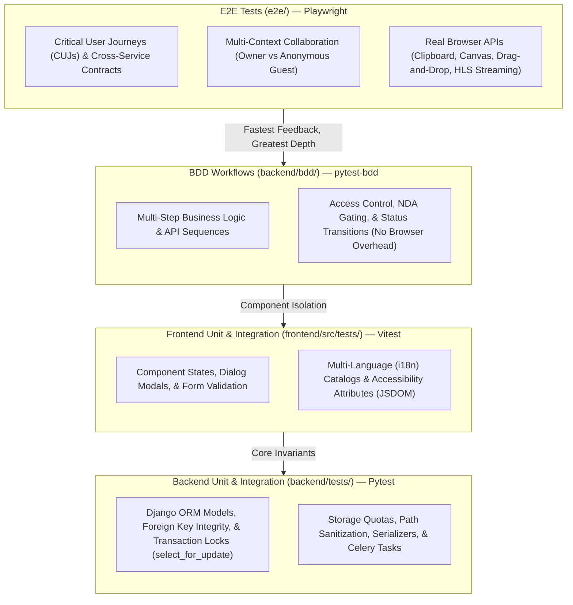
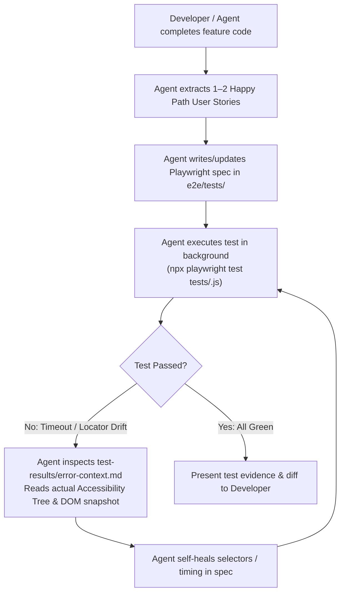

# End-to-End (E2E) Testing & Agentic QA Strategy

## Overview

This document outlines the architecture, execution principles, and AI-assisted automation strategy for End-to-End (E2E) browser testing in ConeShare using Playwright. It defines the boundary between E2E and lower-level test suites (`backend/tests`, `backend/bdd`, `frontend/src/tests`), details critical user journey patterns, and establishes guidelines for AI coding agents to author, debug, and maintain resilient smoke tests.

---

## 1. Testing Pyramid & Division of Responsibility

To prevent test suites from becoming slow, flaky, or redundant, Coneshare organizes testing into four complementary tiers:



### Responsibility Matrix

| Layer | Environment | Core Question | Target Coverage | Anti-Patterns (Do NOT Test Here) |
| :--- | :--- | :--- | :--- | :--- |
| **`e2e/` (Playwright)** | Real Chromium / WebKit (Node host) | *"Does the integrated multi-service application work seamlessly for a real user in a real browser?"* | Top 5–10 Critical User Journeys (CUJs), external share link access, real video streaming, clipboard, cookies. | 10+ permutations of form inputs, invalid email formats, quota arithmetic edge cases (99MB vs 100MB). |
| **`backend/bdd/` (pytest-bdd)** | Django API Client + Python | *"Do multi-step business policies and workflow rules operate correctly across backend services?"* | Multi-endpoint business sequences (upload -> set NDA -> invite -> access tracking). | Browser DOM, CSS styles, client-side JS bundles. |
| **`frontend/src/tests/` (Vitest)** | JSDOM + MSW mocks | *"Do UI components render expected states and respond to user events in isolation?"* | Modals, dropdown dismissals, tabs, form validations, i18n string catalogs. | Real cross-origin cookies, Go file streaming proxy, DB transactions. |
| **`backend/tests/` (pytest)** | SQLite / PostgreSQL + Django | *"Are models, security invariants, transactions, and background tasks correct and robust?"* | ORM transactions, `select_for_update` concurrency, quota math, IDOR checks, Celery task retries. | Browser rendering, visual layout. |

---

## 2. Core E2E Design Patterns in Coneshare

### 2.1 Multi-Context Collaboration (Owner vs. Anonymous Guest)

The defining differentiator of Coneshare is secure document sharing with external tracking. E2E tests leverage Playwright's multi-context capability to validate both sides of the exchange within a single test run without session pollution:

```javascript
test('share link access tracks view session in owner dashboard', async ({ page, browser }) => {
  // 1. Owner creates link in authenticated default browser context
  await page.goto('/documents');
  // ... create link & copy URL ...
  const shareUrl = await page.evaluate(() => navigator.clipboard.readText());

  // 2. Open anonymous guest context (clean cookies, incognito mode)
  const guestContext = await browser.newContext();
  const guestPage = await guestContext.newPage();
  await guestPage.goto(shareUrl);
  await expect(guestPage.locator('.document-viewer, canvas, img')).toBeVisible();
  await guestContext.close();

  // 3. Back in Owner context, verify real-time view session was logged
  await page.reload();
  await expect(page.getByRole('table')).toContainText('Anonymous');
});
```

### 2.2 Self-Sufficient Data (Zero Coupling to Pre-Seeded DB)

- **Anti-Pattern**: Hardcoding assumptions that pre-existing files (e.g., `Annual Report.pdf`) exist in the database.
- **Design Rule**: Every test must create its own entities using dynamic, unique timestamps (e.g., `Smoke-Dataroom-${Date.now()}`), preventing collisions across parallel test runs.

### 2.3 Resilient User-Facing Locators

- **Anti-Pattern**: Using fragile CSS selectors (`.btn-primary`), deep XPath expressions, or unverified assumed roles (e.g., looking for `role: 'tab'` when the UI uses stacked sections).
- **Design Rule**: Always query via accessibility roles and user-facing text, using case-insensitive regex to tolerate dynamic internationalization:
  ```javascript
  // Good: Resilient, accessible semantic locator
  await page.getByRole('button', { name: /add dataroom/i }).click();
  await page.getByRole('button', { name: /create dataroom/i }).click();
  await expect(page.getByRole('heading', { level: 1, name: dataroomName })).toBeVisible();
  ```

### 2.4 Asynchronous Background Task Polling

Coneshare processes heavy tasks (PDF page rasterization, video HLS transcoding) asynchronously via Celery.
- **Anti-Pattern**: Hardcoded sleeps (`await page.waitForTimeout(5000)`).
- **Design Rule**: Use `expect.poll()` to wait for asynchronous state transitions:
  ```javascript
  await expect.poll(async () => {
    return await page.getByTestId('render-status-badge').innerText();
  }, { intervals: [1000, 2000], timeout: 30000 }).toMatch(/ready/i);
  ```

---

## 3. Agentic E2E & Coding Assistant Automation Workflow

### 3.1 The Hybrid Model: "Agent-as-Author" vs. "Agent-at-Runtime"

Coneshare adopts the **Agent-as-Author & Self-Healing** paradigm for production pipelines:

1. **Agent-as-Author (PR & CI/CD Gate)**:
   - The coding agent (Agy) writes and debugs standard Playwright `.spec.js` files upon feature completion.
   - The verified test is committed to [`e2e/tests/`](file:///Users/xiez/coneshare/e2e/tests) and runs statically in CI/CD.
   - **Benefits**: 100% deterministic, zero LLM API cost in CI, sub-10 second execution.
2. **Agent-at-Runtime (Release Pre-Flight / Exploratory Smoke)**:
   - Before major releases, an agent can be triggered interactively to run exploratory smoke tests across the live staging environment, reading accessibility trees and reporting UX anomalies.

### 3.2 The Automated Authoring & Self-Healing Loop

When implementing a new feature or refactoring UI, follow this 4-step loop:



### 3.3 Non-Interactive Runner Configuration

In [`e2e/playwright.config.js`](file:///Users/xiez/coneshare/e2e/playwright.config.js), the HTML reporter must always be configured with `open: 'never'`:

```javascript
export default defineConfig({
  reporter: [
    ['html', { open: 'never' }],
    ['list'],
  ],
  // ...
});
```

> [!IMPORTANT]
> Never leave `reporter: 'html'` with default options in non-interactive environments. On test failure, Playwright will spawn a local HTTP server and halt the process indefinitely waiting for interactive `Ctrl+C`.

---

## 4. Execution Commands Reference

| Action | Command | Scope |
| :--- | :--- | :--- |
| **Run All E2E Tests** | `cd e2e && npx playwright test` | Complete browser test suite against running Docker stack. |
| **Run Targeted Spec** | `cd e2e && npx playwright test tests/datarooms.spec.js` | Single feature verification during development. |
| **Run with Debug UI** | `cd e2e && npx playwright test --ui` | Interactive visual debugger with DOM time-travel. |
| **Inspect Last Report** | `cd e2e && npx playwright show-report` | Opens HTML report with execution traces and snapshots. |

---

## 5. CI/CD Integration & Nightly Regression Pipeline

To balance fast developer feedback with comprehensive full-stack verification, testing execution is split across two tiers:

```
┌────────────────────────────────────────────────────────┐
│ PR / Push CI (build-ci.yml: ~3-5 mins)                 │
│  - Path detection (dorny/paths-filter)                 │
│  - Backend unit tests (pytest backend)                 │
│  - Frontend whitelisted Vitest (npm run test:whitelist)│
│  - MCP server unit tests                               │
└────────────────────────────────────────────────────────┘
                           │
                           ▼ Nightly Schedule (02:00 CST / 18:00 UTC)
┌────────────────────────────────────────────────────────┐
│ Nightly CI (nightly.yml: ~15-20 mins)                  │
│  - Full Docker Compose stack with ClamAV               │
│  - Database migration & E2E seed data generation       │
│  - Service healthcheck polling loop                    │
│  - All Playwright E2E suites (make test.e2e)           │
│  - Backend BDD feature suites (pytest bdd/)            │
│  - Playwright HTML / Trace / Screenshot artifact dump  │
│  - Automated GitHub Issue creation on failure          │
└────────────────────────────────────────────────────────┘
```

### 5.1 Pipeline Configuration (`.github/workflows/nightly.yml`)

The Nightly workflow automates end-to-end regression testing with the following stages:
1. **Container Bootstrap**: Executes `COMPOSE_PROJECT_NAME=coneshare docker-compose --profile malware up -d --build` to include the ClamAV malware scanner.
2. **Healthcheck Loop**: Polls backend (`/api/v1/public/settings/`), frontend (`:5173`), and Go core (`/health`) until HTTP 200 is returned.
3. **Seed Data Invariant**: Automatically runs `python manage.py migrate` and `python manage.py create_test_data` to ensure `test@coneshare.com` and initial folders/documents exist in clean environments.
4. **Diagnostic Retention**: On failure, uploads Playwright traces, error screenshots, and container logs with a 7-day retention period for post-mortem debugging.

