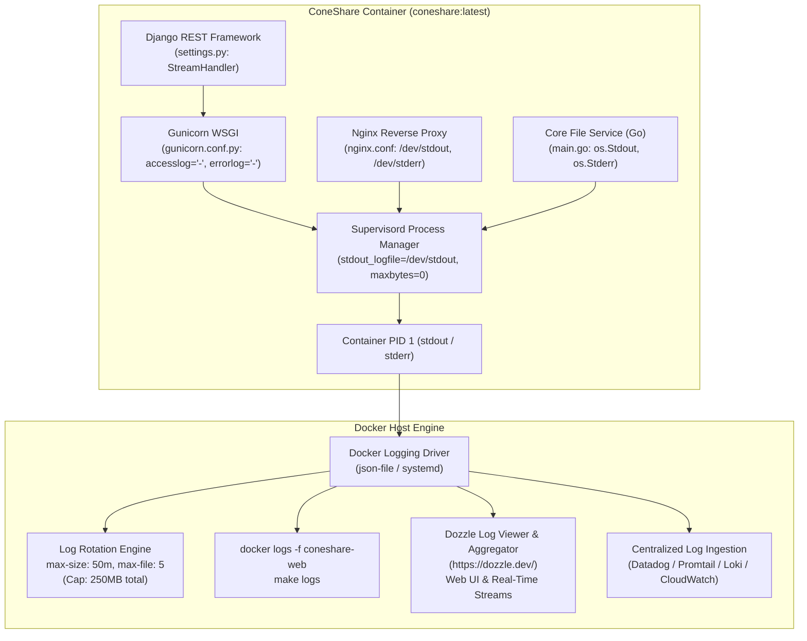

# Logging Strategy & Architecture

## Overview
This document outlines the architectural decisions, design logic, and operational runbook for the **12-Factor Container-Native Logging Strategy** implemented across the ConeShare monorepo and deployment configurations.

---

## 1. Design Logic & Strategic Decisions

| Decision Area | Choice | Rationale |
|---|---|---|
| **Logging Paradigm** | 12-Factor App (Factor XI: Logs as Event Streams) | Containers do not manage or store internal log files. All processes write unbuffered event streams directly to `stdout` and `stderr`. |
| **Log Storage & Rotation** | Docker Host Daemon (`json-file` / `local`) | Managed by container runtime (`max-size: 50m`, `max-file: 5` in production; `20m` / `3` in dev). Eliminates host disk exhaustion without in-container cron/logrotate daemons. |
| **Application Layer (Django)** | `logging.StreamHandler(sys.stdout)` | Root logger captures all application events. Redundant propagation handlers on child loggers (`django.request`, `tasks`) are removed to prevent duplicate lines. |
| **WSGI Server (Gunicorn)** | Stream to `stdout` (`"-"`) and `stderr` (`"-"`) | Directs access and error logs to process standard descriptors without intermediate log files (`gunicorn.access.log`, `gunicorn.error.log`). |
| **Reverse Proxy (Nginx)** | Stream to `/dev/stdout` and `/dev/stderr` | Captures HTTP proxy access and error logs without requiring manual `tail -f nginx/*.log` commands or volume mounts. |
| **Process Supervisor** | Zero-seek stream forwarding (`logfile_maxbytes=0`) | Supervisord forwards child stdout/stderr streams to PID 1. Disabling internal rotation avoids fatal ioctl/seek errors on Linux device streams. |
| **Volume Mounts** | Removed `../logs:/home/coneshare/logs` bind mount | Eliminates multi-container file contention where `web`, `celery`, and `video_worker` containers concurrently wrote to and rotated the exact same host file. |
| **Log Viewer & Web UI** | [Dozzle](https://dozzle.dev/) | Ultra-lightweight (~15MB RAM), zero-database real-time log viewer and aggregator streaming directly from `/var/run/docker.sock`. |

---

## 2. Architecture & Data Flow



---

## 3. Worker Isolation & Stream Separation

In production compose setups (`coneshare-compose`), logs are strictly partitioned by container role:

```
├── coneshare-web     --> HTTP requests, Nginx access/error, API views, Core file server
├── coneshare-celery  --> Document conversion tasks (LibreOffice, PDF page rasterization)
└── coneshare-video   --> Video transcoding tasks (FFmpeg HLS stream generation)
```

Each container manages its own stream. Conversion tasks no longer compete with or pollute the HTTP access log.

---

## 4. Operator Runbook: How to Read & Filter Logs

### A. Background Task & Document Conversion Logs
Background task lifecycle events (`received`, `succeeded`, `raised unexpected`) stream directly to the worker container:

```bash
# Follow live document & PDF preview conversions:
docker logs -f coneshare-celery

# Follow live video transcoding conversions:
docker logs -f coneshare-video

# Check recent conversion tasks (last 100 lines):
docker logs --tail 100 coneshare-celery

# Check conversions in the last 15 minutes with timestamps:
docker logs --since 15m -t coneshare-celery

# Filter for task completion or errors:
docker logs coneshare-celery 2>&1 | grep -E "succeeded|failed|ERROR"

# Filter conversions for a specific Document ULID:
docker logs coneshare-celery 2>&1 | grep "01HY..."
```

### B. Web Server & Nginx HTTP Traffic
```bash
# Stream all web, proxy, and API activity:
docker logs -f coneshare-web

# Follow only Nginx HTTP requests:
docker logs -f coneshare-web | grep -E '"(GET|POST|PUT|DELETE|HEAD|PATCH)'

# Filter for HTTP client/server errors (4xx and 5xx):
docker logs coneshare-web 2>&1 | grep -E '" [45][0-9]{2} '

# Follow Nginx proxy warnings or upstream connection failures:
docker logs -f coneshare-web 2>&1 | grep -E '\[(error|warn|crit)\]'
```

### C. Real-Time Web Log Viewer & Aggregator ([Dozzle](https://dozzle.dev/))
For operators preferring a lightweight web interface over terminal commands, [Dozzle](https://dozzle.dev/) provides a real-time, zero-configuration web dashboard that aggregates event streams across all ConeShare containers.

* **Resource Footprint**: Minimal (~15MB RAM, single Go binary, zero database requirements).
* **Key Capabilities**:
  * **Unified Container Dashboard**: Aggregates `coneshare-web`, `coneshare-celery`, `coneshare-video`, `coneshare-beat`, `coneshare-postgres`, and `coneshare-redis` in one UI.
  * **Split-Screen Viewing**: Observe frontend API calls in `coneshare-web` side-by-side with document rasterization jobs in `coneshare-celery`.
  * **Real-Time Full-Text & Regex Search**: Instantly filter live streams by Document ULID, share link slug, HTTP status, or error stack traces.
  * **Download & Export**: Download raw container log streams directly from the browser for offline debugging.

#### Deployment Configuration (Docker Compose)
Dozzle can be deployed alongside ConeShare by mounting the Docker daemon socket as read-only:

```yaml
services:
  dozzle:
    image: amir20/dozzle:latest
    container_name: coneshare-dozzle
    restart: unless-stopped
    volumes:
      - /var/run/docker.sock:/var/run/docker.sock:ro
    ports:
      - "127.0.0.1:8888:8080" # Bind to localhost or reverse proxy
    environment:
      DOZZLE_LEVEL: info
      DOZZLE_NO_ANALYTICS: "true"
      # Optional: Restrict to ConeShare containers only
      # DOZZLE_FILTER: "name=coneshare-*"
```

> [!NOTE]
> Dozzle streams logs directly from the Docker daemon socket (`/var/run/docker.sock`). When containers are recreated during version upgrades (e.g., via `install.sh`), Dozzle automatically detects and begins streaming the new container instances. To preserve pre-upgrade logs across container teardowns, archive container logs prior to `docker compose down` or configure Docker host-persistent logging drivers (`journald`).

---

## 5. Technical Quirks & Solution Gotchas

### 1. The `RotatingFileHandler` Multi-Process Race Condition
* **Problem:** Python's standard library `RotatingFileHandler` is not multi-process safe. When multiple Gunicorn worker processes or Celery processes concurrently reached `maxBytes = 500MB`, simultaneous rollover attempts raised `FileNotFoundError`, lost records, or corrupted backups.
* **Resolution:** Replaced all file handlers with `StreamHandler` pointing to `sys.stdout`. Host-level rotation is delegated entirely to Docker daemon.

### 2. The Multi-Container Host Volume Collision
* **Problem:** `web`, `celery`, and `video_worker` containers previously all mounted `../logs:/home/coneshare/logs`, writing to the same `coneshare.log` file simultaneously from three separate OS containers.
* **Resolution:** Removed the host volume mount. Each container outputs to its own isolated container stdout.

### 3. The `tail -f` Inode Trap
* **Problem:** The previous container entrypoint ran `Popen("tail -f /home/coneshare/logs/*.log", shell=True)`. Because `tail -f` follows file descriptors rather than file names, any file rotation caused `tail` to stay bound to the archived file (`coneshare.log.1`), permanently freezing output to `docker logs`. Furthermore, wildcard globbing failed to match subdirectories (ignoring `nginx/*.log` completely).
* **Resolution:** Removed the `tail -f` subprocess entirely. Supervisord forwards all child standard streams directly to container PID 1.

### 4. Supervisord `/dev/stdout` Rotation Trap
* **Problem:** When redirecting Supervisor `stdout_logfile` to `/dev/stdout`, Supervisor by default attempts to check file size and rotate it when reaching 50MB. Calling `seek`/`stat` on Linux device streams raises fatal ioctl errors.
* **Resolution:** Always configure `stdout_logfile_maxbytes=0` and `stderr_logfile_maxbytes=0` when directing Supervisor logs to `/dev/stdout` or `/dev/stderr`.

### 5. Celery Worker Root Logger Hijacking
* **Design Decision:** Celery workers retain `CELERY_WORKER_HIJACK_ROOT_LOGGER = True` (Celery's default). This ensures Celery worker outputs automatically include worker process attribution (e.g. `[INFO/ForkPoolWorker-1]`) and task timing metadata when executing concurrent document/video conversion tasks.

---

## 6. Migration & Host Upgrade Note

For existing deployments upgrading to this logging architecture:
* Any historical log files remaining under the host `../logs/` directory (e.g., `coneshare.log`, `gunicorn.access.log`, `nginx/access.log`) are no longer referenced or updated.
* Operators may safely archive or delete `../logs/` on the host filesystem to reclaim disk space.

