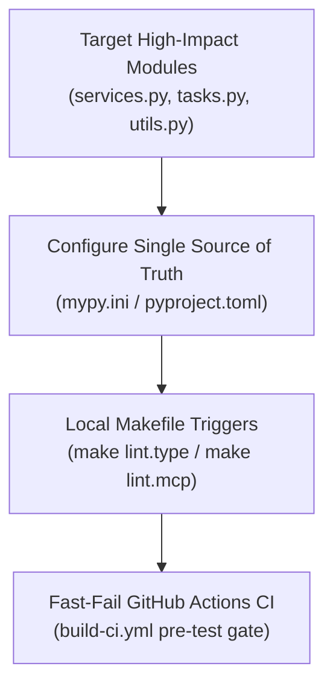

# Python Static Typing & Mypy Strategy

This document outlines the static type-checking architecture and progressive typing strategy for Python services across the Coneshare monorepo, covering both the core Django backend (`backend/`) and the standalone Model Context Protocol server (`mcp-server/`).

---

## 1. Motivation & Business Value

Coneshare handles high-stakes document governance, virtual datarooms (VDRs), and real-time viewing telemetry. Introducing static typing via `mypy` addresses three critical needs:

1. **Defect Prevention in Complex Business Logic**:
   Core workflows (e.g., quota tracking, permission cascading, watermark generation, ZIP streaming) involve multi-step transformations. Static typing catches `None` reference errors, incompatible argument types, and dict/list shape mismatches before tests or production runs.
2. **First-Class AI Tooling Contracts (MCP)**:
   In `mcp-server/`, `FastMCP` reflects Python type annotations at runtime to synthesize JSON Schemas (`inputSchema`) for AI clients (Claude, Cursor, Antigravity). Incorrect type hints directly corrupt the tool schemas presented to LLMs.
3. **Developer Velocity & Confident Refactoring**:
   Clear type signatures on services and utility functions allow engineers and AI coding agents to refactor shared libraries without silent breakage.

---

## 2. Progressive Adoption Model

Rather than enforcing strict global typing across hundreds of legacy Django files simultaneously—which generates thousands of noisy warnings—Coneshare employs a **targeted, progressive adoption strategy**:



### Targeted Module Whitelist
Type enforcement is focused on the highest-value functional layers:
- **Application Services**: `*/services.py` across all apps (`sharelinks`, `datarooms`, `documents`, `automations`, `cloudfiles`, `core`).
- **Asynchronous Tasks**: `*/tasks.py` across Celery task modules.
- **Utility Libraries**: `*/utils.py`, `documents/spreadsheet_utils.py`, `documents/pdf_utils.py`, `core/i18n_utils.py`, `backend/utils.py`.
- **Core Engine Subsystems**: `documents/renderers/`, `documents/fileserver.py`, `sharelinks/archive.py`.
- **Remote MCP Server**: 100% coverage of all `mcp-server/coneshare_mcp/` tools and clients.

---

## 3. Configuration & Single Source of Truth (DRY)

To avoid duplicate file path lists across development tools and CI, the target files are declared **exclusively in the tool configuration files**:

| Layer | Configuration File | Role |
|---|---|---|
| **Backend** | [`backend/mypy.ini`](../../backend/mypy.ini) | Maintains the `files =` list of 31 core business logic modules. |
| **MCP Server** | [`mcp-server/pyproject.toml`](../../mcp-server/pyproject.toml) | Declares `[tool.mypy] files = ["coneshare_mcp"]`. |
| **Local Commands** | [`Makefile`](../../Makefile) | Invokes bare `mypy` delegating file discovery to configs. |
| **Continuous Integration** | [`.github/workflows/build-ci.yml`](../../.github/workflows/build-ci.yml) | Runs bare `mypy` inside the setup Python runner environment. |

### Key `mypy.ini` Settings
- **`django-stubs` Plugin**: `mypy_django_plugin.main` resolves Django ORM syntheses (e.g. `ForeignKey` `*_id` attributes, reverse relation managers like `versions`, and dynamic model fields).
- **`explicit_package_bases = True` & `mypy_path = .`**: Prevents module naming collisions across Django apps with identical filenames (e.g., `core.services` vs. `sharelinks.services`).
- **`follow_imports = silent`**: Prevents transitive import cascades from un-annotated legacy views or third-party packages.
- **`no_implicit_optional = False`**: Maintains compatibility with idiomatic `arg: T = None` defaults without requiring mass rewrites.
- **`ignore_missing_imports = True`**: Safely bypasses untyped third-party libraries (e.g., `reportlab`, `pdf2image`, `kombu`).

---

## 4. Developer Workflows

### Running Type Checks Locally
Run type checks directly or as part of the test suites via Docker Compose:

```bash
# Full backend check across all 31 target files:
make lint.type

# Fast single-file or single-module check during feature development:
make lint.type TARGET=sharelinks/services.py

# MCP server check across all 10 MCP files:
make lint.mcp

# Test suites include type checks (similar to make test.front linting):
make test      # Runs mypy static type checks followed by pytest
make test.mcp  # Runs mypy static type checks followed by unittest discover
```

### GitHub Actions CI Gate
In `.github/workflows/build-ci.yml`, static type checking runs immediately after dependency installation and before unit/BDD test execution:
- **`test-backend`**: Runs `mypy` inside `./backend` (gated by `SECRET_KEY` and `FIELD_ENCRYPTION_KEY` env vars so `django-stubs` can import `backend.settings`).
- **`test-mcp`**: Runs `mypy` inside `./mcp-server` using the `[dev]` optional dependency group.
- **Fast-Fail**: Type failures abort the job within ~3 seconds, preserving GitHub Actions runner minutes.

---

## 5. Expansion Guidelines

When adding a new service, utility, or task module to static type checking:

1. **Do not modify `Makefile` or `build-ci.yml`**.
2. Add the relative path to the `files =` list under `[mypy]` in `backend/mypy.ini`:
   ```ini
   files =
       ...
       mynewapp/services.py,
   ```
3. Run `make lint.type TARGET=mynewapp/services.py` to verify locally.
4. Adhere to modern Python 3.12 syntax:
   - Use builtin generics (`list[str]`, `dict[str, Any]`, `set[int]`).
   - Use union syntax (`str | None` instead of `Optional[str]`).
   - Explicitly annotate container variables on assignment when initializing empty structures (`items: list[Document] = []`).
