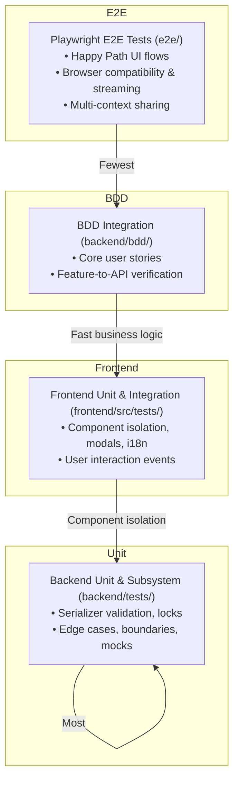

# Coneshare Testing Strategy: BDD vs. Unit Testing

This document outlines the testing strategy for the Coneshare monorepo, clarifying the split of responsibilities between behavior-driven integration tests (`backend/bdd`) and technical unit/integration tests (`backend/tests`).

---

## 1. BDD (Behavior-Driven Development) in `backend/bdd`

*   **Target Audience**: Product Managers, Stakeholders, Developers, QA.
*   **Core Question**: *"Are we building the **right** product?"* (Ensures the business requirements are met).
*   **Focus**: 
    *   **High-Level Flows**: End-to-end backend workflows using the Django API test client (e.g., creating a sharelink, authenticating, and downloading a document).
    *   **Happy Paths**: Standard user journeys.
    *   **Critical Security Behaviors**: Ensuring restricted access returns a `403` or a redirect under specific rules (e.g., video downloads blocked when watermarking is enabled).
*   **What to Avoid**: 
    *   Edge case combinations (e.g., testing 10 different invalid email formats).
    *   Unit logic, utility functions, or direct database model manipulation (unless asserting end states).
    *   Mocking internal components heavily (mocking external APIs like Dropbox is fine, but the internal Django services should run integration-style).

---

## 2. Unit/Integration Tests in `backend/tests`

*   **Target Audience**: Developers.
*   **Core Question**: *"Are we building the product **right**?"* (Ensures technical correctness, robustness, and performance).
*   **Focus**:
    *   **Edge Cases & Boundaries**: Extreme values, missing fields, malformed inputs, null handlers.
    *   **App Layers**: Grouped by Django application and module:
        *   `test_views.py`: API status codes, response shapes, query parameter edge cases.
        *   `test_serializers.py`: DRF field validations, custom validation hooks (e.g., path structure checks).
        *   `test_services.py`: Quota calculations, copying metadata, directory traversals.
        *   `test_tasks.py`: Mocking FFmpeg subprocess calls, checking temporary folder deletions, chunk retry thresholds.
    *   **Database Constraints**: Asserting uniqueness constraints, transaction rollbacks, or tracking query counts to prevent N+1 queries.

---

## 3. End-to-End (E2E) Browser Testing in `e2e`

*   **Target Audience**: Developers, QA, Release Engineers, AI Coding Agents.
*   **Core Question**: *"Does the integrated multi-service application work seamlessly for a real user in a real browser?"*
*   **Focus**:
    *   **Critical User Journeys (CUJs)**: Top 5–10 golden paths (e.g., Owner uploads document -> creates protected link -> anonymous visitor views document in clean browser context -> real-time view telemetry logged).
    *   **Real Browser Subsystems**: Canvas PDF rendering (`pdfjs`), HLS video chunk streaming, clipboard access, cookie propagation.
    *   **Agentic QA & Self-Healing**: Automated Happy Path authoring and self-healing for smoke verification.
*   **Detailed Strategy**: See [End-to-End (E2E) Testing & Agentic QA Strategy](./e2e-testing-strategy.md).

---

## 4. The Organization Strategy (The Testing Pyramid)

To prevent the test suite from becoming slow and redundant, we structure testing as a pyramid:

### Workflow Guideline for New Features

1.  **Define Behavior (BDD / E2E)**: For backend APIs, write a `.feature` file in `backend/bdd/`. For full-stack user journeys, write or prompt an agent to generate a Playwright spec in `e2e/tests/` (see [E2E Testing Strategy](./e2e-testing-strategy.md)).
2.  **Cover Edge Cases (Unit & Frontend)**: Write serializer, service, and task unit tests in `backend/tests/` to verify boundaries (e.g., file size exactly at 100MB quota vs. 1 byte over quota), and Vitest component tests in `frontend/src/tests/`.
3.  **Resolve Bugs (Unit)**: When fixing a bug, **write a unit test**, not a BDD or E2E test. BDD and E2E features should only change when user-facing requirements change.
