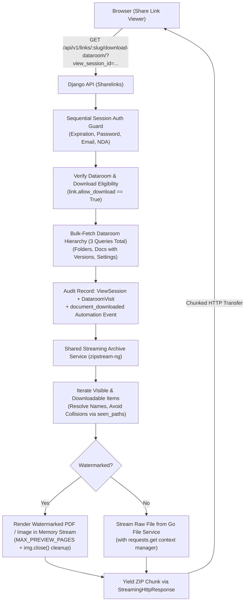

# Design Plan: Whole-Dataroom Streaming Download (Issue #404)

## 1. Overview & Objectives

Issue [#404](https://github.com/coneshare/coneshare/issues/404) addresses a key limitation in Coneshare's virtual datarooms: external viewers currently can only download individual folders one by one, resulting in disjointed `.zip` downloads and poor UX on multi-folder rooms.

This plan specifies the architecture to introduce **"Download all"** for the whole dataroom, replacing the legacy in-memory buffering with a **low-memory, non-blocking HTTP streaming ZIP engine**.

---

## 2. Key Architecture Decisions



| Decision Area | Chosen Strategy | Motivation |
| :--- | :--- | :--- |
| **Delivery Model** | Synchronous HTTP Streaming (`StreamingHttpResponse` + `zipstream-ng`) | Zero temporary disk usage; instant download start in browser; constant low RAM footprint (~50MB). |
| **API Endpoint** | `GET /api/v1/links/<slug>/download-dataroom/` | Clean semantics, isolated OpenAPI contract, decouples whole-room logic from folder routes. |
| **Hierarchy Querying** | Bulk Prefetching (3 queries total) | Prevents recursive $O(N)$ N+1 queries during streaming; builds the tree in Python memory in sub-10ms. |
| **Collision Avoidance** | `seen_paths` disambiguation set | Appends ` (1)`, ` (2)` to avoid duplicate filenames silently overwriting each other inside the archive. |
| **Resource Safety** | Context-managed HTTP sockets + explicit Pillow `img.close()` | Prevents socket leaks on client abort (`GeneratorExit`) and releases bitmap memory immediately. |
| **Scope of Refactoring** | Shared streaming archive service for whole-room & single-folder | Upgrades [`DataroomFolderDownloadView`](file:///Users/xiez/coneshare/backend/sharelinks/views.py#L2854), removing the in-memory `BytesIO` TODO. |
| **Audit & Activity Log** | `ViewSession.downloaded_at = now`, `DataroomVisit(item_type='folder', item_name=dataroom.name, item_path='/')` | 100% backward compatible with existing analytics and models; no database migrations needed. |
| **Browser Execution** | Native browser download (anchor link dispatch) | Streams directly to client disk without exhausting JavaScript tab heap memory. |
| **Error Resilience** | Resilient stream + `<filename>_error.txt` placeholder | Prevents single corrupted file from crashing an entire multi-gigabyte dataroom download. |

---

## 3. Detailed Component Design

### 3.1 Backend Architecture

#### A. Dependency Addition
- Add `zipstream-ng>=1.8.0` to [`backend/requirements.txt`](file:///Users/xiez/coneshare/backend/requirements.txt).
  `zipstream-ng` generates compliant ZIP64 archives on-the-fly from generators without requiring seekable streams.

#### B. Shared Streaming Service (`backend/sharelinks/services/archive.py`)
Encapsulate folder and document tree traversal, permission checks, and file generation:
- **`generate_dataroom_archive_stream(link, request, viewer_email, root_folder=None)`**:
  1. **Bulk-Fetch Hierarchy (3 Queries Total)**:
     - Query 1: `all_folders = DataroomFolder.objects.filter(dataroom=link.dataroom)`
     - Query 2: `all_docs = DataroomDocument.objects.filter(dataroom=link.dataroom, document__deleted_at__isnull=True).select_related('document').prefetch_related('document__versions')`
     - Query 3: `all_settings = ShareLinkDataroomSetting.objects.filter(share_link=link)`
  2. **In-Memory Tree Assembly**:
     - Index settings by `dataroom_folder_id` and `dataroom_document_id`.
     - Group child folders and documents by `folder_id` (with `None` representing root items).
     - Filter out items where `setting.is_visible == False` or `setting.allow_download == False`.
     - For video files: strictly skip download if `setting.enable_watermark == True`.
  3. **Path Sanitization & Collision Avoidance**:
     - Track `seen_paths = set()` across the archive.
     - For each item, compute sanitized name: `get_valid_filename(item.name)`.
     - If path already exists in `seen_paths`, append incremental index: `f"{stem} ({i}){ext}"`.
     - Add to `seen_paths` and yield into `ZipStream`.
  4. **Safe File Streaming & Resource Disposal**:
     - **Watermarked Documents / Images**:
       - Check `doc.page_count`: if greater than `MAX_PREVIEW_PAGES`, fall back to vector-watermarked PDF.
       - Execute watermarking (`_generate_watermarked_pdf` / `_generate_watermarked_image`) within `try/finally` ensuring all Pillow `Image` handles call `.close()`.
       - Stream the resulting `BytesIO` buffer into `ZipStream`, then release the buffer immediately.
     - **Raw Files**:
       - Retrieve internal download URL via `fileserver_client.generate_download_url(storage_key, is_internal=True)`.
       - Stream chunks using `with requests.get(download_url, stream=True) as resp:`. If the client disconnects (`GeneratorExit`), the `with` block guarantees immediate socket closure.
  5. **Stream Fault Tolerance**:
     - Wrap per-file processing in a `try/except Exception`: on failure, log the error and insert `<sanitized_name>_error.txt` into the ZIP explaining that the file could not be retrieved, allowing the remaining files to stream uninterrupted.

#### C. Dedicated Endpoint (`DataroomDownloadAllView`)
- **Route**: `path('links/<slug:slug>/download-dataroom/', views.DataroomDownloadAllView.as_view(), name='dataroom-download-all')`
- **Session verification**:
  - Uses `_verify_share_link_session_authorization(link, request, require_session=False, nda_status_code=403)`.
  - Returns `403 Forbidden` if `not link.allow_download`.
  - Returns `400 Bad Request` if 0 downloadable files exist in the entire room.
- **Audit & Analytics**:
  - Updates `view_session.downloaded_at = timezone.now()`.
  - Records or updates `DataroomVisit` with `item_type='folder'`, `item_name=link.dataroom.name`, `item_path='/'`.
  - Dispatches `_dispatch_automation_event(link, 'document_downloaded', ...)`.
- **RFC 5987 / 6266 Content-Disposition**:
  - Compute `ascii_name = get_valid_filename(link.dataroom.name) or f"dataroom_{link.slug}"`.
  - Compute `utf8_name = quote(f"{link.dataroom.name}.zip")`.
  - Set header: `response['Content-Disposition'] = f'attachment; filename="{ascii_name}.zip"; filename*=UTF-8\'\'{utf8_name}'`.
  - Return `StreamingHttpResponse(stream_generator, content_type='application/zip')`.

#### D. Refactor Single Folder Download
- Update [`DataroomFolderDownloadView`](file:///Users/xiez/coneshare/backend/sharelinks/views.py#L2854) to delegate its ZIP generation to `generate_dataroom_archive_stream(link, request, viewer_email, root_folder=folder)`.

---

### 3.2 Frontend Architecture

#### A. Viewer Header Action (`DocumentViewerHeader.jsx`)
- Add props:
  - `isDownloadAllAllowed: boolean`
  - `onDownloadAll: () => void`
  - `isDownloadingAll: boolean`
- Render a **"Download all"** button beside the Q&A trigger:
  ```jsx
  {isDownloadAllAllowed && (
    <Button
      type="button"
      variant="outline"
      size="sm"
      className="h-8 rounded-full px-2.5 text-xs text-gray-700 hover:bg-gray-100 border-gray-200"
      onClick={onDownloadAll}
      disabled={isDownloadingAll}
      aria-label={t('viewer.downloadAll')}
      title={t('viewer.downloadAll')}
    >
      <Download className="h-3.5 w-3.5" />
      <span className="ml-1.5 hidden font-semibold sm:inline">{t('viewer.downloadAll')}</span>
    </Button>
  )}
  ```

#### B. Trigger Flow & Client-Side Tree Validation (`DataroomViewer.jsx`)
- **Client-Side Gating**:
  - Inspect `scopeData` (or items list) to verify if at least one visible document or subfolder allows download.
  - Set `isDownloadAllAllowed = Boolean(link?.allow_download) && hasDownloadableItems`.
  - If `hasDownloadableItems` is false, hide the button to prevent native navigation into error responses.
- **Trigger**:
  - `handleDownloadAll()` appends `view_session_id=${viewId}` if present.
  - Constructs URL: `/api/v1/links/${slug}/download-dataroom/?view_session_id=${viewId}`.
  - Dispatches hidden `<a href={downloadUrl} download="...">` to stream directly to disk.
  - Displays transient success toast: `t('viewer.downloadStarted')`.

#### C. Internationalization (`locales/*/translation.json`)
Strictly adhere to **Rule 7** (all 6 locales in the same change) and **Rule 10** (no inline `defaultValue` in JSX `t()` calls):
- **English (`en`)**:
  - `"viewer.downloadAll"`: `"Download all"`
  - `"viewer.downloadStarted"`: `"Download started"`
  - `"viewer.noDownloadableItems"`: `"No downloadable items in this dataroom."`
- **Simplified Chinese (`zh-hans`)**:
  - `"viewer.downloadAll"`: `"全部下载"`
  - `"viewer.downloadStarted"`: `"下载已开始"`
  - `"viewer.noDownloadableItems"`: `"此数据室中没有可下载的文件。"`
- **German (`de`)**:
  - `"viewer.downloadAll"`: `"Alles herunterladen"`
  - `"viewer.downloadStarted"`: `"Download gestartet"`
  - `"viewer.noDownloadableItems"`: `"Keine herunterladbaren Dateien in diesem Datenraum."`
- **French (`fr`)**:
  - `"viewer.downloadAll"`: `"Tout télécharger"`
  - `"viewer.downloadStarted"`: `"Téléchargement commencé"`
  - `"viewer.noDownloadableItems"`: `"Aucun élément téléchargeable dans ce dataroom."`
- **Russian (`ru`)**:
  - `"viewer.downloadAll"`: `"Скачать всё"`
  - `"viewer.downloadStarted"`: `"Загрузка началась"`
  - `"viewer.noDownloadableItems"`: `"В этой комнате данных нет доступных для скачивания файлов."`
- **Dutch (`nl`)**:
  - `"viewer.downloadAll"`: `"Alles downloaden"`
  - `"viewer.downloadStarted"`: `"Download gestart"`
  - `"viewer.noDownloadableItems"`: `"Geen downloadbare bestanden in deze dataroom."`

---

## 4. Testing Strategy

1. **Backend Unit & API Tests (`backend/tests/sharelinks/test_views.py`)**:
   - `test_download_dataroom_success`: Verifies complete archive structure with subfolders, nested files, and root loose files using `zipfile.ZipFile`.
   - `test_download_dataroom_bulk_queries`: Verifies with `django_assert_num_queries` that database queries do not scale with folder depth.
   - `test_download_dataroom_filename_collisions`: Verifies duplicate document names in the same folder are safely renamed (`Agreement (1).pdf`).
   - `test_download_dataroom_permissions`: Verifies unauthorized, expired, password-gated, and NDA-gated requests return expected status codes.
   - `test_download_dataroom_respects_file_download_flags`: Ensures files with `allow_download=False` or watermarked videos are excluded from the ZIP.
   - `test_download_dataroom_watermarking`: Verifies PDFs with watermark enabled are converted on-the-fly and Pillow/file handles are disposed.
   - `test_download_dataroom_resilience`: Mocks a single file failure and verifies the rest of the archive downloads and contains `<filename>_error.txt`.
   - `test_download_dataroom_audit_and_automation`: Asserts `view_session.downloaded_at` is set, `DataroomVisit` is logged, and automation event is dispatched.

2. **Frontend Component Tests (`frontend/src/tests/components/viewer/DataroomViewer.test.jsx`)**:
   - Verifies "Download all" button appears when downloads are permitted and downloadable items exist.
   - Verifies "Download all" button is hidden when `allow_download` is disabled or all items are restricted.
   - Verifies clicking the button triggers native anchor click with the correct API endpoint and view session query param.
   - Add test paths to [`frontend/vitest.whitelist.json`](file:///Users/xiez/coneshare/frontend/vitest.whitelist.json).

---

## 5. Execution Steps

1. **Backend Foundation**:
   - Add `zipstream-ng>=1.8.0` to `backend/requirements.txt`.
   - Implement `generate_dataroom_archive_stream` generator in `backend/sharelinks/services/archive.py` with bulk-querying, collision handling, and context-managed streaming.
   - Create `DataroomDownloadAllView` in `backend/sharelinks/views.py` and register URL route in `backend/sharelinks/urls.py`.
   - Refactor `DataroomFolderDownloadView` to delegate to `generate_dataroom_archive_stream`.
2. **Backend Tests**:
   - Add test cases in `backend/tests/sharelinks/test_views.py` and execute targeted test command inside container:
     `COMPOSE_PROJECT_NAME=coneshare docker-compose exec backend pytest tests/sharelinks/test_views.py -k test_download_dataroom`
3. **Frontend Integration**:
   - Update `DocumentViewerHeader.jsx` to render the "Download all" button.
   - Wire `handleDownloadAll` with client-side tree gating in `DataroomViewer.jsx`.
   - Add i18n keys to all 6 locale files.
4. **Frontend Tests**:
   - Update `DataroomViewer.test.jsx` and `DocumentViewerHeader.test.jsx`.
   - Run targeted Vitest command:
     `COMPOSE_PROJECT_NAME=coneshare docker-compose exec frontend npx vitest run src/tests/components/viewer/DataroomViewer.test.jsx`
