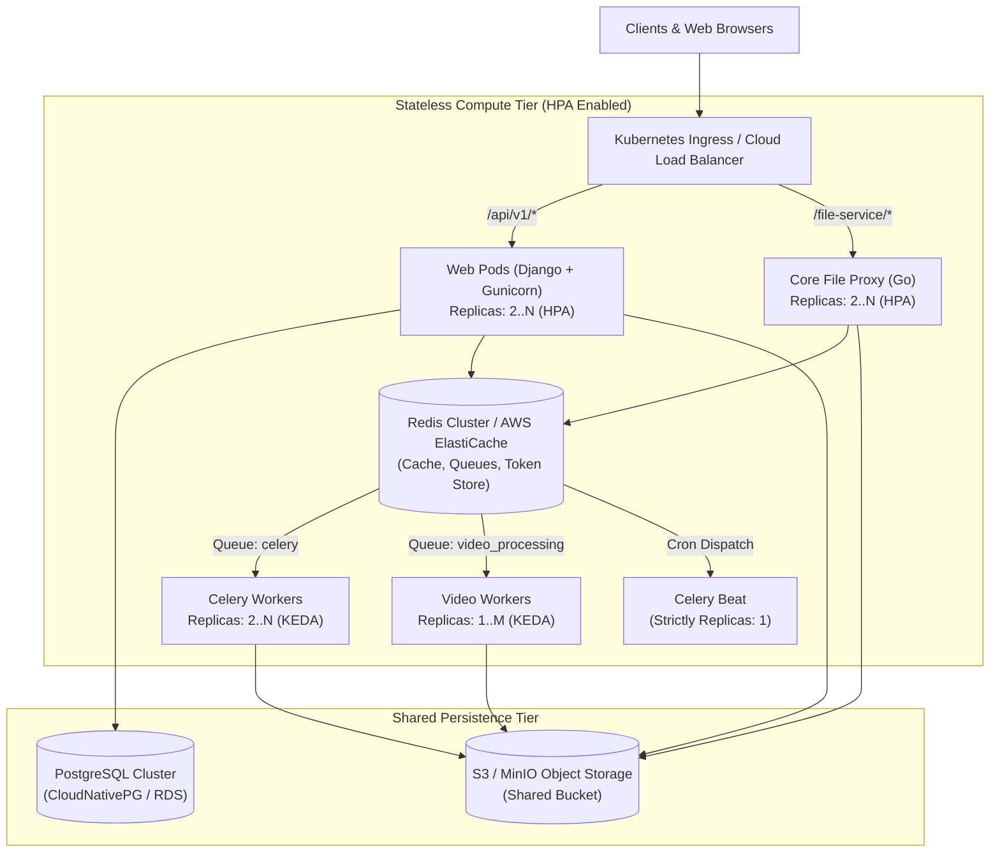

# ☸️ Kubernetes (K8s) Horizontal Scaling Architecture Plan

> **Status:** Planned / Architecture Backlog  
> **Origin:** Derived from Issue #377 (Gunicorn container concurrency optimization) and K8s readiness assessment.  
> **Target Goal:** Enable ConeShare to scale horizontally across multi-node Kubernetes clusters via Horizontal Pod Autoscaler (HPA) and cloud-native managed services.

---

## 1. 📌 Overview & Context

With the resolution of Issue #377, ConeShare's web tier now defaults to a conservative, memory-safe footprint (`GUNICORN_WORKERS=2`, `GUNICORN_THREADS=2`), adhering to the cloud-native principle of **Scale Out (Horizontal Pods) over Scale Up (Fat Containers)**.

However, moving from Docker Compose (single-host) to Kubernetes (multi-node, dynamic autoscaling) requires eliminating stateful singletons and local filesystem dependencies.

---

## 2. 🏛️ Target Cloud-Native Architecture

---

## 3. 🔍 Architectural Bottlenecks & Required Workstreams

### Workstream 1: Go File Proxy Token Store Externalization
- **Affected File:** [`core/main.go`](file:///Users/xiez/dev/coneshare/core/main.go#L48-L55)
- **Current State:** 
  Download and upload tokens are stored in an in-memory map (`tokenStore = make(map[string]TokenInfo)`).
- **The Problem:** 
  In a multi-pod K8s deployment, a token generated by Django on Pod A will return `404 Token Not Found` if the client's file upload or streaming request is routed to Pod B.
- **Action Items:**
  1. **Option A (Shared Redis Store - Recommended for fast invalidation):**
     - Connect Go service to Redis using `go-redis/v9`.
     - Store token metadata with Redis TTL:
       `SET coneshare:token:<token_uuid> <json_payload> EX <expires_in_seconds>`.
     - Automatically evicts expired tokens without requiring the background cleanup goroutine.
  2. **Option B (Stateless Cryptographic Tokens):**
     - Replace random UUID tokens with HMAC-SHA256 signed tokens (or PASETO/JWT) containing `storage_key`, `filename`, `purpose`, and `exp`.
     - Any `core` pod with the shared secret can validate and authorize the request without a network hop.

---

### Workstream 2: File Storage Persistence (Object Storage vs RWX PV)
- **Affected Files:** [`backend/backend/settings.py`](file:///Users/xiez/dev/coneshare/backend/backend/settings.py), [`core/main.go`](file:///Users/xiez/dev/coneshare/core/main.go)
- **Current State:** 
  Docker Compose binds local host directory volumes (`../data:/data`, `~/.coneshare-data:/storage`).
- **The Problem:** 
  K8s pods scheduled across different physical worker nodes cannot share standard `ReadWriteOnce` (RWO) host volumes.
- **Action Items:**
  1. **Standardize on S3/MinIO for Multi-Node Deployments:**
     - Enforce `STORAGE_TYPE=MINIO` (or AWS S3, Cloudflare R2, Google Cloud Storage) as the default for K8s installations.
     - Ensure Go service (`core`) supports direct S3 streaming / presigned URL generation, or configure a high-performance `ReadWriteMany` (RWX) CSI driver (e.g. CephFS, NFS, AWS EFS).
  2. **Decouple Local Temporary Files:**
     - Ensure video transcoding (`ffmpeg`) and PDF rasterization (`pdf2image`) tasks write scratch files to K8s `emptyDir` volumes (backed by node SSDs or RAM) and immediately flush artifacts to object storage.

---

### Workstream 3: Container & Process Decoupling
- **Affected Files:** [`backend/Dockerfile`](file:///Users/xiez/dev/coneshare/backend/Dockerfile), [`backend/docker.dist/runtime/web.supervisor.conf`](file:///Users/xiez/dev/coneshare/backend/docker.dist/runtime/web.supervisor.conf)
- **Current State:** 
  The single container image uses `supervisord` to bundle Nginx, Gunicorn, and Core service inside a single OS container.
- **The Problem:** 
  Bundling reverse proxy and multiple backend services inside one pod prevents independent scaling, violates the single-concern container principle, and obscures per-service resource monitoring.
- **Action Items:**
  1. **Deconstruct Monolith into Independent K8s Deployments:**
     - **`coneshare-web` Deployment:** Pure Python/Django running Gunicorn (`workers=2`, `threads=2`). Scales on HTTP traffic.
     - **`coneshare-core` Deployment:** Pure Go file proxy binary. Scales on file I/O & streaming bandwidth.
     - **`coneshare-celery` Deployment:** Background async tasks (`celery` queue). Scales on Redis queue length via KEDA.
     - **`coneshare-video-worker` Deployment:** Dedicated transcode worker (`video_processing` queue) with strict CPU quotas.
     - **`coneshare-celery-beat` Deployment:** Singleton scheduler (`replicas: 1`).
  2. **Ingress Layer:**
     - Offload SSL termination, Nginx reverse proxying, client IP extraction (`X-Forwarded-For`), and gzip/brotli compression to the Kubernetes Ingress Controller (e.g. `ingress-nginx`, Traefik, or AWS ALB).

---

### Workstream 4: Health Checks & Graceful Termination

- **Action Items:**
  1. **Liveness & Readiness Probes:**
     - Web: `/api/v1/_health/` for readiness (verifies DB & Redis connectivity) and `/api/v1/_liveness/` (verifies process response).
     - Core: Add a lightweight `/healthz` endpoint returning HTTP 200.
  2. **Graceful Shutdown Lifecycle:**
     - Configure `terminationGracePeriodSeconds: 60` on K8s deployments.
     - Handle `SIGTERM` in Gunicorn (`timeout = 60`) and Celery (`worker.soft_time_limit` & `time_limit`) to ensure active document conversions or file uploads are not abruptly aborted during pod rolling upgrades.

---

## 4. 🚀 Implementation Roadmap

| Phase | Milestone | Deliverables |
| :--- | :--- | :--- |
| **Phase 1** | Go Proxy Token Store Migration | Migrate `core/main.go` `tokenStore` to Redis or HMAC signed tokens. |
| **Phase 2** | S3 / MinIO Multi-Node Verification | Audit all file operations (watermarking, Poppler rasterizer, video transcoding) under S3 object storage without local shared disk. |
| **Phase 3** | K8s Manifests & Helm Chart | Create official `charts/coneshare` Helm chart with decoupled Deployments, Services, Ingress, and HPA definitions. |
