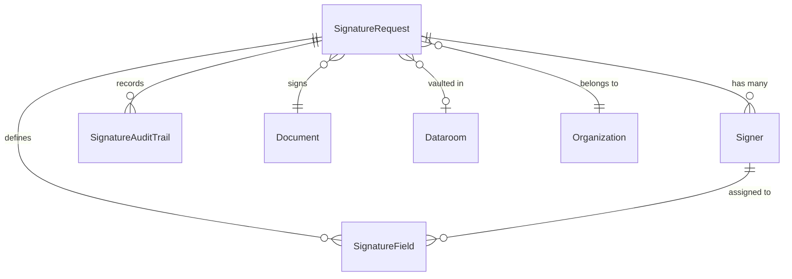
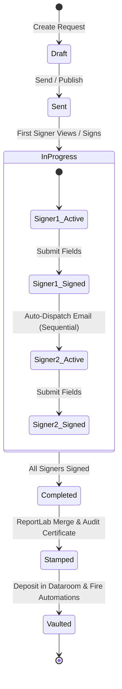

# 🖋️ Feature Plan: Native eSignature (eSign) for Share Links & Virtual Datarooms

- **Target Issue:** [coneshare/coneshare#445](https://github.com/coneshare/coneshare/issues/445)
- **Status:** Core Phase 1 & Phase 2 Implemented (DB Migration, i18n Localization, and E2E Pending)
- **Architecture Lead:** Pair Programming Agent
- **Target Components:** `backend/sharelinks/`, `backend/esign/`, `backend/documents/`, `backend/datarooms/`, `backend/automations/`, `frontend/src/components/`, `frontend/src/pages/`, `mcp-server/`

---

## 1. Executive Summary & Problem Framing

Coneshare provides document sharing (`ShareLink`), virtual datarooms (`Dataroom`), page-level engagement analytics (`ViewSession`, `PageView`), Q&A threads, and clickwrap NDA gating (`NDAAcceptance`).

However, high-stakes transactions (fundraising, M&A due diligence, legal contracts, sales proposals) suffer from three critical bottlenecks:
1. **Workflow Fragmentation:** Users must leave Coneshare, export PDFs, upload to third-party tools (DocuSign, PandaDoc), and reconfigure permissions.
2. **Pre-Signature Blind Spots:** Third-party eSign tools are black boxes between sending and signing. Senders lose page-by-page reading telemetry right when the counterparty is evaluating clauses.
3. **Legal Enforceability of Clickwrap:** Plain markdown NDA clickwraps are insufficient for formal transactions. Regulated deals require **visual signature blocks, signer metadata, tamper-evident SHA-256 cryptographic hashes, and an appended Certificate of Completion**.

### Phased Roadmap Overview

```mermaid
flowchart TD
    subgraph Phase1["Phase 1: Lightweight PDF NDA Gatekeeper & Stamping"]
        P1_A["PDF NDA Attachment on ShareLink/Dataroom"] --> P1_B["Viewer Signature Pad (Draw / Type)"]
        P1_B --> P1_C["Server Vector Stamping (ReportLab + pypdf)"]
        P1_C --> P1_D["SHA-256 Integrity Hash & Audit Certificate Page"]
        P1_D --> P1_E["Vault Archiving & Executed PDF Download"]
    end

    subgraph Phase2["Phase 2: Full Document eSign & Deal Closing"]
        P2_A["Drag-and-Drop Field Placement Editor"] --> P2_B["1-to-1 & 1-to-Many Signable Links"]
        P2_B --> P2_C["Pre-Sign Reading Telemetry in ViewSession"]
        P2_C --> P2_D["Multi-Signer State Machine (Sequential / Parallel)"]
        P2_D --> P2_E["Automations Event (document.signed) & VDR Auto-Vault"]
    end
```



---

## 2. Technical Stack & Governance Rule Compliance

Every step of this plan strictly complies with `docs/tech_stack_guidelines.md` and `Makefile`:

| Rule | Project Requirement | Implementation in eSign |
|---|---|---|
| **Rule 1** | `select_for_update()` before quota-sensitive reads | When creating executed PDF copies or vaulting signed agreements into organization storage, acquire `OrganizationStorage.objects.select_for_update()` inside `transaction.atomic()` before quota evaluation. |
| **Rule 2** | Never expose raw `metadata` JSONFields in public serializers | All `SignatureField` and `SignatureRequest` public serializers expose explicit, sanitized attributes (e.g. `field_type`, `coordinates`, `page_number`), never raw internal connection or system metadata. |
| **Rule 3** | Guard invalid state transitions + write failing test first (TDD) | Reject signing already-signed documents, out-of-order sequential signing, or editing fields after dispatch with `ValidationError(code="invalid_state")`. Write failing pytest unit tests before implementing guards. |
| **Rule 4** | Never send tokens or credentials in URL query parameters | All signer submission tokens and credentials must be passed in the `POST` request body or `Authorization` header, never in GET query parameters. |
| **Rule 6** | Validate range on client numeric fields | Coordinates (`x`, `y`, `width`, `height`) must have strict serializer validators: `min_value=0.0`, `max_value=100.0`. Page numbers must be `>= 1`. |
| **Rules 7 & 10** | Strict frontend i18n in all 6 locale catalogs (`no inline defaultValue`) | All UI strings and error messages added to `frontend/src/locales/{en,zh-hans,de,fr,ru,nl}/translation.json`. In components, call `t('key')` directly without `defaultValue` or fallback strings. |
| **Rules 8 & 9** | Organization-scoped storage key validation & root confinement | Stamped PDFs and signature PNGs use deterministic keys `org_{org_id}/signatures/...` validated through `validate_storage_key_organization_prefix()` rejecting traversal (`..`). |
| **Rule 11** | RFC 6266 `Content-Disposition` header compliance | Downloads for executed PDFs and audit certificates force ASCII fallback (`filename="{ascii_name}"`) and UTF-8 encoding (`filename*=UTF-8''{quote(name)}`). |
| **Rule 12** | Enforce access permissions at all depth levels | Validates that signers only access their assigned fields, and link viewers cannot access documents without completed NDA acceptance. |

---

## 3. Phase 1: Lightweight PDF NDA Gatekeeper & One-Click Execution

### 3.1 Data Architecture Enhancements

#### Modifications to `backend/sharelinks/models.py`
1. **`ShareLink`**:
   - `nda_type = models.CharField(max_length=10, choices=[('text', 'Plain Text / Markdown'), ('pdf', 'PDF Document')], default='text')`
   - `nda_document = models.ForeignKey('documents.Document', null=True, blank=True, on_delete=models.SET_NULL, related_name='nda_share_links')`
   - `nda_document_version = models.ForeignKey('documents.DocumentVersion', null=True, blank=True, on_delete=models.SET_NULL, related_name='nda_version_share_links')` (pins exact source bytes; updating the document does not silently alter active NDA terms)
   - `nda_source_sha256 = models.CharField(max_length=64, blank=True, default='')`
   - `nda_pdf_storage_key = models.CharField(max_length=512, blank=True, default='')`
   - Note: Modifying `nda_document_version`, `nda_source_sha256`, or `nda_text` must atomically bump `ShareLink.nda_version` so previously accepted sessions re-prompt against the new revision without mutating past `NDAAcceptance` evidence.
2. **`NDAAcceptance`**:
   - `signer_name = models.CharField(max_length=255, blank=True, default='')`
   - `signer_title = models.CharField(max_length=255, blank=True, default='')`
   - `signer_company = models.CharField(max_length=255, blank=True, default='')`
   - `signer_email = models.EmailField(blank=True, default='')`
   - `signature_type = models.CharField(max_length=10, choices=[('draw', 'Drawn Canvas'), ('type', 'Typed Font')], default='draw')`
   - `signature_image_storage_key = models.CharField(max_length=512, blank=True, default='')`
   - `executed_pdf_storage_key = models.CharField(max_length=512, blank=True, default='')`
   - `original_doc_sha256 = models.CharField(max_length=64, blank=True, default='')`
   - `signed_doc_sha256 = models.CharField(max_length=64, blank=True, default='')`
   - `seal_method = models.CharField(max_length=24, choices=[('visual_hash', 'Visual + Hash'), ('pades_x509', 'PAdES X.509 Seal')], default='visual_hash')`

### 3.2 PDF Stamping & Vector Overlay Engine

Leverage existing `reportlab` (v4.4.4) and `pypdf` (v6.21.4) dependencies in `backend/sharelinks/views.py`:

1. **Coordinate Mapping & Inversion:**
   - DOM coordinates are top-left based: `(x%, y%)`.
   - PDF coordinates are bottom-left points (72 DPI):
     $$\text{pdf\_x} = \frac{x}{100.0} \times \text{page\_width}$$
     $$\text{pdf\_y} = \text{page\_height} - \left(\frac{y}{100.0} \times \text{page\_height}\right) - \text{pdf\_field\_height}$$
2. **In-Memory Transparent Overlay Generation:**
   - Generate a single-page PDF with `ReportLab` (`reportlab.pdfgen.canvas.Canvas`).
   - Draw the signature PNG using `canvas.drawImage(image_stream, pdf_x, pdf_y, width, height, mask='auto')`.
   - Render metadata strings (Full Name, Title, Company, Timestamp, Verified Email) below or alongside the signature block.
3. **Merging with Original Vector Content:**
   - Read the original PDF template via `pypdf.PdfReader`.
   - Calculate SHA-256 of the pristine document: `hashlib.sha256(original_pdf_bytes).hexdigest()`.
   - Apply `target_page.merge_page(overlay_page)` to preserve text vectors and crispness.
4. **Appended Certificate of Completion (Audit Trail Page):**
   - Build a standalone final page using `ReportLab` `SimpleDocTemplate` and `Table`:
     - **Header:** Coneshare Official Audit Certificate with unique Verification ID.
     - **Transaction Summary:** Target ShareLink / Dataroom, Document Name, Completion Timestamp (UTC).
     - **Signer Identity Summary:** Full Name, Title, Company, Email Address, Verification Method (Session OTP / Magic Link / Direct), IP Address, User-Agent string.
     - **Visual Signature Evidence:** Embedded thumbnail of the captured signature.
     - **Cryptographic Verification Box:** Pristine Document SHA-256 vs Executed Document SHA-256.
   - Append to the end of `PdfWriter` before writing to storage.
5. **Cryptographic PAdES Sealing & Canonical Byte Immutability:**
   - **Optional/Recommended PKI PDF Seal (`pyHanko`):** Visual stamping + SHA-256 text alone does not embed a PDF Signature Dictionary recognizable by Adobe Acrobat / Poppler `pdfsig`. After appending the Certificate of Completion, sign the finalized PDF bytes using `pyHanko` with a platform/organization X.509 signing certificate (PAdES-B-B / B-T) so third-party validators detect any post-execution tampering immediately.
   - **Content-Addressed & Byte-Immutable Storage:** Persist executed artifacts under `{org_id}/signatures/{artifact_id}/{signed_doc_sha256}.pdf` (Rule 8). Derivative page preview renders (PNG/WebP) or viewer-session watermarks must be generated as separate derivatives on read and **never** rewrite canonical sealed PDF bytes.

```
+--------------------------------------------------------------------------+
|                       CONESHARE AUDIT CERTIFICATE                        |
|                     Certificate of Completion (eSign)                    |
+--------------------------------------------------------------------------+
| Document Name: Mutual_NDA_2026.pdf           Envelope ID: 01HZX876...    |
| Status: EXECUTED & SEALED                    Timestamp: 2026-11-06 15:20 |
+--------------------------------------------------------------------------+
| SIGNER DETAILS                                                           |
| Name: Alex Vance                             Email: alex@example.com     |
| Title: Managing Partner                      Company: Horizon Ventures   |
| IP Address: 198.51.100.42                    Auth: Verified Email (OTP)  |
| Signature: [ Visual Signature Stamp ]                                    |
+--------------------------------------------------------------------------+
| CHRONOLOGICAL AUDIT LOG                                                  |
| 2026-11-06 15:18:02 UTC - Link Opened by IP 198.51.100.42                |
| 2026-11-06 15:18:45 UTC - Email OTP Verified for alex@example.com        |
| 2026-11-06 15:19:30 UTC - NDA Previewed (Pages 1-3 viewed)               |
| 2026-11-06 15:20:11 UTC - Signature Applied and Accepted                 |
+--------------------------------------------------------------------------+
| CRYPTOGRAPHIC INTEGRITY PROOF                                            |
| Original Document SHA-256: e3b0c44298fc1c149afbf4c8996fb92427ae41e46... |
| Executed Document SHA-256: 7f83b1657ff1fc53b92dc18148a1d65dfc2d4b1fa... |
+--------------------------------------------------------------------------+
```

### 3.3 Backend API Endpoints

- `POST /api/v1/links/{slug}/accept-nda/`
  - Upgraded to accept JSON body:
    ```json
    {
      "signer_name": "Alex Vance",
      "signer_title": "Managing Partner",
      "signer_company": "Horizon Ventures",
      "signature_type": "draw",
      "signature_data": "data:image/png;base64,iVBORw0KGgo...",
      "view_session_id": "01HZX..."
    }
    ```
  - Performs validation, executes ReportLab stamping, generates Certificate of Completion, computes SHA-256 hashes, saves `NDAAcceptance`, updates session state `nda_accepted_version`, and returns `200 OK`.
- `GET /api/v1/links/{slug}/nda-download/`
  - Allows the link owner (or authorized signer) to download the executed PDF.
  - Implements Rule 11 with RFC 6266 `Content-Disposition`.

### 3.4 Frontend UI Components

1. **Owner Settings (`LinkSheet.jsx`):**
   - Radio selector under "Require NDA":
     - `Plain Text / Markdown` (existing textarea).
     - `PDF Template` (file picker from user documents or immediate PDF upload).
2. **Viewer Gate (`NdaGateModal.jsx` / `ShareLinkViewerPage.jsx`):**
   - For `nda_type == 'pdf'`, renders the PDF in a scrollable container with a bottom execution bar: *"Read & Sign to Access"*.
   - Clicking *"Review & Sign"* opens the Signature Pad Modal.
3. **Dual-Mode Signature Capture Component (`SignatureCapturePad.jsx`):**
   - **Tab 1: Draw:** HTML5 `<canvas>` with smooth Bézier curves, clear button, and stroke smoothing.
   - **Tab 2: Type:** Text input with choice of handwriting styles (using SIL OFL font `DancingScript-Regular.ttf` loaded in CSS).
   - Form inputs: Full Name (pre-filled from verified email if available), Title, Company.
4. **Owner Analytics (`ShareLinkAnalyticsPage.jsx`):**
   - Displays executed NDA records in the NDA Acceptances table.
   - Adds action buttons: *"Download Executed PDF"* and *"View Certificate"*.

---

## 4. Phase 2: Full Document eSignature & Deal Closing

### 4.1 Data Architecture (`backend/esign/models.py`)

Create a dedicated Django app `backend/esign/`:



1. **`SignatureRequest`**:
   - `id` (ULIDField, primary key)
   - `organization` (FK `Organization`, on_delete=CASCADE)
   - `created_by` (FK `User`, on_delete=CASCADE)
   - `document` (FK `documents.Document`, on_delete=CASCADE)
   - `document_version` (FK `documents.DocumentVersion`, on_delete=PROTECT)
   - `dataroom` (FK `datarooms.Dataroom`, null=True, blank=True, on_delete=SET_NULL)
   - `idempotency_key` (CharField, max_length=200, blank=True) (with `UniqueConstraint(fields=['created_by', 'idempotency_key'])` when non-empty)
   - `title` (CharField, max_length=255)
   - `message` (TextField, blank=True)
   - `status` (`draft`, `sent`, `in_progress`, `completed`, `declined`, `voided`)
   - `signing_mode` (`direct_recipients`, `template_link`)
   - `signing_order` (`parallel`, `sequential`)
   - `current_order_index` (IntegerField, default=1)
   - `original_file_sha256` (CharField, max_length=64)
   - `completed_file_storage_key` (CharField, max_length=512, blank=True)
   - `completed_file_sha256` (CharField, max_length=64, blank=True)
   - `certificate_storage_key` (CharField, max_length=512, blank=True)
   - `expires_at` (DateTimeField, null=True, blank=True)
2. **`Signer`**:
   - `id` (ULIDField)
   - `request` (FK `SignatureRequest`, related_name='signers')
   - `email` (EmailField)
   - `name` (CharField, max_length=255, blank=True)
   - `role` (CharField, max_length=100, blank=True) # e.g. "Investor", "Company Rep"
   - `order_index` (IntegerField, default=1)
   - `status` (`pending`, `notified`, `viewed`, `signed`, `declined`)
   - `access_token` (CharField, max_length=64, unique=True, db_index=True) # Secure random token for direct links
   - `signed_at` (DateTimeField, null=True, blank=True)
   - `ip_address` (GenericIPAddressField, null=True, blank=True)
   - `user_agent` (CharField, max_length=255, blank=True)
3. **`SignatureField`**:
   - `id` (ULIDField)
   - `request` (FK `SignatureRequest`, related_name='fields')
   - `signer` (FK `Signer`, null=True, blank=True, related_name='fields')
   - `field_type` (`signature`, `initials`, `date`, `full_name`, `title`, `company`, `text`, `checkbox`)
   - `page_number` (IntegerField, validators=[MinValueValidator(1)])
   - `x` (FloatField, validators=[MinValueValidator(0.0), MaxValueValidator(100.0)])
   - `y` (FloatField, validators=[MinValueValidator(0.0), MaxValueValidator(100.0)])
   - `width` (FloatField, validators=[MinValueValidator(0.0), MaxValueValidator(100.0)])
   - `height` (FloatField, validators=[MinValueValidator(0.0), MaxValueValidator(100.0)])
   - `is_required` (BooleanField, default=True)
   - `value` (TextField, blank=True)
   - `signature_image_storage_key` (CharField, max_length=512, blank=True)
4. **`SignatureAuditTrail`**:
   - `id` (ULIDField)
   - `request` (FK `SignatureRequest`, related_name='audit_events')
   - `signer` (FK `Signer`, null=True, blank=True)
   - `event_type` (`created`, `sent`, `viewed`, `field_updated`, `signed`, `completed`, `declined`, `voided`)
   - `ip_address` (GenericIPAddressField, null=True, blank=True)
   - `user_agent` (CharField, max_length=255, blank=True)
   - `details` (JSONField, default=dict) # Sanitized audit detail only (Rule 2)
   - `timestamp` (DateTimeField, auto_now_add=True)

### 4.2 Interactive Field Placement Editor (`frontend/src/components/esign/`)

- Builds on `PdfJsViewer` canvas layering.
- Left sidebar of draggable field chips: `Signature`, `Initials`, `Date Signed`, `Full Name`, `Text`, `Checkbox`.
- Drop target layer placed above the PDF canvas with absolute CSS percentage positioning:
  ```css
  left: `${field.x}%`;
  top: `${field.y}%`;
  width: `${field.width}%`;
  height: `${field.height}%`;
  ```
- Signer selector palette: Each signer assigned a distinct color palette (e.g. Signer 1: Blue, Signer 2: Green).
- Field properties popover: Toggle `Required`, default value, assigned signer.

### 4.3 Signer Guided Execution Flow (`frontend/src/pages/SignDocumentPage.jsx`)

1. **Signer Landing:** Secure authentication via `access_token` (direct link) or verified viewer session (template link).
2. **Engagement Tracking:** Spawns a `ViewSession` logging page dwell time (`PageView`) before signing.
3. **Guided Next-Field Wizard:** Sticky bottom/top bar with `"Start Signing"` / `"Next Field (2 of 5 remaining)"` that automatically scrolls the viewport smoothly to each pending required field.
4. **Submission & Sealing:**
   - Client sends field values and signature assets to backend.
   - Backend evaluates `Signer.can_sign()` state machine.

### 4.4 Multi-Signer State Machine & Execution Orchestration



- **Sequential Mode Enforcement (Rule 3):**
  ```python
  def can_sign(self) -> bool:
      if self.request.signing_order != 'sequential':
          return self.status in ['pending', 'notified', 'viewed']
      # Must ensure all previous order_index signers have signed
      has_uncompleted_predecessors = self.request.signers.filter(
          order_index__lt=self.order_index
      ).exclude(status='signed').exists()
      return not has_uncompleted_predecessors and self.status in ['pending', 'notified', 'viewed']
  ```
- **Automated Hand-off & Transaction Isolation:** Inside `transaction.atomic()` with `SignatureRequest.objects.select_for_update()`, persist signer completion and verify `original_file_sha256` against `document_version` bytes before sealing. Network calls (SMTP email notifications, webhook delivery, async preview rendering) must **never** run inside the database lock; trigger Celery tasks exclusively via `transaction.on_commit()` alongside a periodic idempotent sweep to recover missed preview renders or stalled notifications.
- **Voiding, Declines & NDA Reset:** Owners can void an in-flight or declined `SignatureRequest` (`status='voided'`) and issue a fresh request without mutating historical `SignatureAuditTrail` rows or already-completed artifacts. For Dataroom NDA gates, bumping the NDA revision (`ShareLink.nda_version`) or resetting a stuck visitor flow supersedes prior state while retaining past `NDAAcceptance` evidence read-only.
- **Sealing & Storage Quota (Rule 1):** Once the final signer submits:
  - Acquire `select_for_update()` on `OrganizationStorage`.
  - Check remaining quota against expected file size.
  - Stamp all field overlays across all pages.
  - Generate the multi-signer *Certificate of Completion*, apply optional `pyHanko` PAdES seal, and write immutable bytes keyed by `completed_file_sha256`.
  - Calculate final SHA-256 and store executed PDF into S3/local storage.

### 4.5 Virtual Dataroom (VDR) & Automations Integration

1. **Vault Auto-Deposit & Subject-Scoped NDA Privacy (Rule 12):**
   - Separate executed files into two distinct VDR vault paths:
     - **Closing Agreements (`1-to-1` deals):** `__datarooms__/{dataroom_id}/Executed/Agreements/{request_id}/{document_name}_signed.pdf` (visible to room owners/collaborators and authorized participants according to `ShareLinkDataroomSetting`).
     - **Visitor NDAs (`Executed/NDAs/`):** `__datarooms__/{dataroom_id}/Executed/NDAs/{viewer_id}-{nda_version}/{document_name}_signed.pdf`.
   - **Strict Isolation Guard:** Executed NDA files (and any file located under `Executed/NDAs/`) must **never** be exposed to sibling Dataroom visitors. Dataroom item listing, page rendering, and download resolvers must enforce an explicit subject-ownership check (`viewer.id` + verified `viewer_email` match, or authenticated room owner/collaborator).
   - Update `DataroomItemOrder` so authorized items immediately appear in the room's document hierarchy without rewriting canonical PDF bytes during preview rendering.
2. **Automations App Triggers:**
   - Dispatch `document.signed` event via `_dispatch_automation_event()` to notify configured Slack, Discord, Webhook, or Email endpoints.

### 4.6 Token Transport Security, Coordinate Bounds & MCP Governance

1. **Scanner-Tolerant Signer Handoff (Extending Rule 4):**
   - Email invitations for direct signers carry the `access_token` inside the URL `#fragment` (`https://.../sign/{request_id}#token=...`), never in query parameters (`?token=...`).
   - On page load, the SPA immediately strips the fragment via `history.replaceState()` and exchanges it via `POST` for an `HttpOnly`, `SameSite=Lax` signer session cookie. Consequently, corporate email link scanners (`GET` prefetchers) cannot consume or reveal single-use signing tokens, and server access logs remain free of credentials.
2. **Strict Payload & Coordinate Validation (Rule 6):**
   - Reject non-finite numbers (`NaN`, `Inf`), page counts outside `[1, 500]`, out-of-bounds boxes where `x + width > 100.0` or `y + height > 100.0`, and unverified/empty signature payloads before touching PDF rendering.
3. **MCP / AI Agent Boundaries:**
   - Expose read-only and preparation tools in `mcp-server/` (`list_signature_requests`, `get_signature_status`, `list_signable_document_versions`).
   - Enforce an explicit safety boundary on mutating tools: AI agents (`APIKey`) may draft signature requests, but **external dispatch (`send_signature_request`) and disabling or weakening a Share Link / Dataroom NDA gate** require human JWT confirmation (or explicit approval gating), and MCP tool responses must strictly redact signer `access_token` and internal signing keys.

---

## 5. Step-by-Step Implementation Sprints

### Phase 1 Breakdown (Estimated 4 Sprints)

- [x] **Sprint 1.1: Backend Data Model & Migration**
  - [x] Add fields (`nda_type`, `nda_document`, `nda_document_version`, `nda_source_sha256`, `nda_pdf_storage_key`, `seal_method`, etc.) to `ShareLink` and `NDAAcceptance` in `backend/sharelinks/models.py`.
  - [x] Generate migration `backend/sharelinks/migrations/0014_ndaacceptance_executed_pdf_storage_key_and_more.py` (not yet applied via `make migrate` per user request).
  - [ ] Run `make migrate` to apply schema changes to the runtime database.
  - [x] Add model & version-bump validation tests (implemented in `backend/tests/sharelinks/test_pdf_nda.py`).
- [x] **Sprint 1.2: PDF Stamping, PAdES Sealing & Audit Certificate Engine**
  - [x] Implement shared vector stamping & sealing engine in `backend/esign/pdf_stamping.py` using `ReportLab` and `pypdf`.
  - [x] Implement coordinate inversion and dual-mode signature rendering (drawn PNG vs typed).
  - [x] Implement Audit Certificate page generation and content-addressed canonical storage (`{org_id}/signatures/.../{sha256}.pdf`).
  - [x] Add unit tests verifying byte integrity, vector text preservation, and SHA-256 hashes (`backend/tests/esign/test_pdf_stamping.py`).
  - [ ] *(Optional)* Add `pyHanko` PKI X.509 PAdES cryptographic signature embedding.
- [x] **Sprint 1.3: Upgraded NDA API Endpoints**
  - [x] Upgrade `ShareLinkAcceptNDAView` in `backend/sharelinks/views.py` to process signature payloads, verify `nda_source_sha256` against pinned `DocumentVersion`, and execute server-side stamping.
  - [x] Add `ShareLinkNDAPreviewView`, `ShareLinkNDADownloadView` with RFC 6266 headers (Rule 11), and `Executed/NDAs/` subject-scoped isolation across Dataroom views and ZIP archives (`backend/sharelinks/archive.py`).
  - [x] Write test suite covering authenticated/anonymous fallback, vaulting, isolation, and tamper hash verification (`backend/tests/sharelinks/test_pdf_nda.py`).
- [~] **Sprint 1.4: Frontend PDF NDA Gate & Signature Pad** *(i18n deferred)*
  - [x] Create `frontend/src/components/viewer/SignatureCapturePad.jsx` (Draw + Type tabs).
  - [x] Update `frontend/src/components/viewer/NDAForm.jsx` to render PDF preview, trigger signature capture, and download executed PDFs.
  - [ ] Add all i18n keys to all 6 translation files (`en`, `zh-hans`, `de`, `fr`, `ru`, `nl`) per Rule 7 & Rule 10 (explicitly deferred).
  - [x] Add unit tests in `frontend/src/tests/components/viewer/SignatureCapturePad.test.jsx`.
- [x] **Sprint 1.5: Owner Settings & Analytics Integration**
  - [x] Update `frontend/src/components/links/LinkSheet.jsx` to toggle between Plain Text and PDF Template NDA.
  - [x] Add executed PDF download action links in `frontend/src/pages/ShareLinkAnalyticsPage.jsx`.
  - [x] Run `npm run lint` / `npm run test:whitelist` (`test.front`) and targeted backend `pytest` + `mypy` suites.

---

### Phase 2 Breakdown (Estimated 5 Sprints)

- [x] **Sprint 2.1: `backend/esign` App Scaffolding & Data Models**
  - [x] Create `backend/esign/` Django app (`SignatureRequest` with `document_version` + `idempotency_key`, `Signer`, `SignatureField`, `SignatureAuditTrail`, `SignerPageView`).
  - [x] Configure serializers ensuring Rule 2 (no raw metadata leaked) and Rule 6 (strict finite numeric & `x + width <= 100` / `y + height <= 100` validators).
  - [x] Generate `backend/esign/migrations/0001_initial.py` (not yet applied via `make migrate` per user request).
  - [ ] Run `make migrate` to apply schema changes to the runtime database.
- [x] **Sprint 2.2: Multi-Page Vector Stamping & Sealing Engine for Arbitrary Fields**
  - [x] Generalize the ReportLab + `pypdf` pipeline in `backend/esign/pdf_stamping.py` to handle multi-page, multi-field, and multi-signer placement.
  - [x] Implement comprehensive *Certificate of Completion* with multi-party audit signatures and byte-immutable archival.
  - [x] Write unit tests in `backend/tests/esign/test_pdf_stamping.py`.
- [x] **Sprint 2.3: Multi-Signer State Machine, VDR Isolation & API Endpoints**
  - [x] Implement `select_for_update()` state transition guards (Rule 3), idempotency checks, void/decline flows, and `transaction.on_commit()` notification dispatch (`backend/esign/services.py`, `tasks.py`).
  - [x] Implement public signing endpoints and scanner-tolerant `#fragment` -> `HttpOnly` cookie exchange (`backend/esign/views.py`).
  - [x] Integrate with `automations` (`document_signed` event) and Dataroom vault auto-deposit (`Executed/Agreements/` vs visitor-isolated `Executed/NDAs/`), tested in `backend/tests/esign/test_workflows_and_views.py`.
- [~] **Sprint 2.4: Frontend Field Placement Studio** *(Simplified click-to-place v1 implemented)*
  - [x] Build simplified click-to-place studio + numeric box positioning over `usePdfDocument` / `PdfPage` in `frontend/src/pages/SignaturesPage.jsx` with signer assignment, send/void/delete, `#token` link copying, and audit/analytics views.
  - [ ] *(Optional Upgrade)* Extract dedicated drag-and-drop `SignatureFieldEditor.jsx` with `SignatureFieldEditor.test.jsx`.
- [~] **Sprint 2.5: Signer Guided Execution Flow** *(i18n deferred)*
  - [x] Build `frontend/src/pages/SignDocumentPage.jsx` with `#fragment` token handoff (`history.replaceState`), guided next-field scrolling, pre-sign `SignerPageView` engagement tracking, signature adoption, and executed PDF download (+ `SignDocumentPage.test.jsx`).
  - [ ] Complete all 6 translation catalogs (explicitly deferred).
- [~] **Sprint 2.6: MCP Tools, Verification & End-to-End Validation**
  - [x] Add read-only/draft MCP tools in `mcp-server/coneshare_mcp/tools/esign.py` (`list_signature_requests`, `get_signature_request`, `create_signature_request_draft`, `void_signature_request`) with token redaction and no external dispatch tool, plus unit tests in `mcp-server/tests/test_esign_tools.py`.
  - [x] Run targeted backend `pytest` + `mypy`, `npm run lint` + `npm run test:whitelist`, `test.mcp` (`mypy` + `unittest`), and OpenAPI schema validation (`spectacular --validate` + `openapi_spec_validator`).
  - [ ] Add Playwright E2E spec in `e2e/tests/esign_flow.spec.js` (covering sequential signing, void/re-issue, and `Executed/NDAs/` cross-visitor isolation).

---

## 6. Verification & Quality Gates

Run the exact commands defined in `Makefile`:

```bash
# 1. Database Migrations
make migrate

# 2. Backend Unit and Integration Tests
make test

# 3. Frontend Lint & Whitelisted Tests
make test.front

# 4. Compile Translation Catalogs
make compile.po

# 5. OpenAPI Schema Generation & Validation
make api.schema.validate
```
