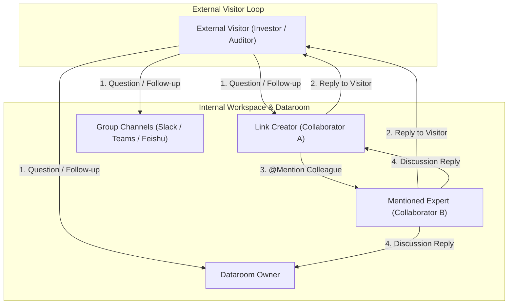

# 🔔 Feature Plan: Comprehensive Q&A Notifications, Visitor Reply Loop & Teammate @Mentions

- **Status:** Proposed / Pending Implementation
- **Architecture Lead:** Pair Programming Agent
- **Target Components:** `backend/sharelinks/`, `backend/automations/`, `backend/datarooms/`, `frontend/src/components/qna/`, `frontend/src/components/viewer/`
- **Related Specs:** [`docs/features/share-link-qna.md`](../docs/features/share-link-qna.md), [`plans/todo/dataroom_collaboration_notifications_phase2_plan.md`](dataroom_collaboration_notifications_phase2_plan.md)

---

## 1. Executive Summary & Problem Framing

Coneshare provides contextual Q&A across Virtual Datarooms and standalone Share Links via [`QnAThread`](../../backend/sharelinks/models.py) and [`QnAMessage`](../../backend/sharelinks/models.py).

While the current system dispatches basic inbound events (`qna_thread_created`, `qna_message_created`) to link owners, the workflow suffers from three major notification gaps:

1. **Visitor Feedback Black Hole (No External Reply Notification):**
   When an owner or collaborator replies to a question in the admin panel, the external visitor (`Viewer`) receives **no email or external alert**. The visitor has to manually re-open and refresh the share link to discover replies.
2. **Missing Internal Team Mentioning (@Mentions):**
   In complex M&A, fundraising, or legal diligence, questions often require input from specific domain experts (e.g. Legal, Tax, Engineering). Currently, team members cannot `@mention` a specific collaborator in a thread to alert them directly.
3. **Coarse Notification Routing:**
   Notifications are routed strictly to the **ShareLink creator** or **Dataroom owner**. Other collaborators who participated in a thread or were assigned to resolve it do not automatically receive follow-up replies without manually checking the dashboard.

---

## 2. Notification Architecture & Matrix



### Complete Event Dispatch Matrix

| Event Type | Triggered By | Recipient(s) | Channel(s) | Delivery Policy |
|---|---|---|---|---|
| **`qna_thread_created`** | External Visitor | • Link Creator<br>• Dataroom Owner (if room rule active)<br>• Subscribed Webhooks | • Email (forced bypass suppression)<br>• Slack / Discord / Feishu | Coalesced (60s debounce window for multi-question sessions) |
| **`qna_message_created`** (Visitor reply) | External Visitor | • Link Creator<br>• Thread Subscribers (Watchers)<br>• Subscribed Webhooks | • Email<br>• IM Webhooks | Coalesced (60s debounce window) |
| **`qna_reply_to_viewer`** | Internal Team Member | • **Original Asking Visitor** (`Viewer.email`) | • **Direct Visitor Email** (with secure single-click magic link) | **Instant Dispatch** (immediate delivery) |
| **`qna_team_reply`** | Internal Team Member | • Thread Watchers (Participants)<br>• Assigned User (`assigned_to`) | • Email<br>• In-App / Dashboard | Coalesced (60s debounce window) |
| **`qna_mentioned`** | Internal Team Member | • **Specifically Mentioned User(s)** | • **Dedicated Mention Email**<br>• Direct IM `<at>` Ping | **Instant Penetration** (bypasses all debounce/mute rules) |
| **`qna_assigned`** | Internal Team Member | • **Newly Assigned Collaborator** | • Assignment Email | Instant Dispatch |

---

## 3. External Visitor Reply Loop (Closing the Feedback Gap)

### 3.1 Trigger Conditions & Verification
- When an authenticated user posts a reply in [`OwnerQnAManager.jsx`](../../frontend/src/components/qna/OwnerQnAManager.jsx):
  - Check if the target thread was started by a visitor: `thread.created_by_viewer` or `thread.created_by_view_session.viewer_email`.
  - Check that the visitor's email is present and verified.

### 3.2 Secure One-Click Jump Back (Scanner-Tolerant Magic Link)
- Email template: `sharelinks/qna_visitor_reply_email.html`.
- Content:
  - Sender: `Coneshare Notifications <no-reply@coneshare.com>` (with `Reply-To` directed to owner/workspace contact).
  - Headline: *"Alex Vance replied to your question on 'Term Sheet.pdf' in 'Series A Dataroom'"*.
  - Excerpt: First 200 characters of the answer.
  - **CTA Button:** *"View Answer & Continue Discussion"*.
  - **URL Structure:**
    `https://coneshare.com/view/{slug}?accessToken={single_use_token}&threadId={thread_id}`
- On click, the link automatically validates through Coneshare's two-step scanner-tolerant verification, opens the document, and expands the [`QnAPanel.jsx`](../../frontend/src/components/viewer/QnAPanel.jsx) drawer directly to the target thread.

---

## 4. Teammate @Mention System

### 4.1 Frontend Experience ([`OwnerQnAManager.jsx`](../../frontend/src/components/qna/OwnerQnAManager.jsx))
1. **Trigger & Autocomplete:**
   - Typing `@` inside the reply composer triggers an inline dropdown.
   - Autocomplete list queries the active Dataroom team: Dataroom Owner + all active [`DataroomCollaborator`](../../backend/datarooms/models.py) records.
   - Displays user Avatar, Full Name, Email, and Role tag (e.g., `Owner`, `Collaborator - Legal`).
2. **Security & Boundary Isolation:**
   - External visitors using [`QnAPanel.jsx`](../../frontend/src/components/viewer/QnAPanel.jsx) **do not have access to the @mention menu** (prevents internal staff directory leakage to third parties).
3. **Structured Storage:**
   - Text syntax: `@[user:{user_id}:{user_name}]`.
   - API payload: `POST /api/v1/qna-threads/{id}/messages/` accepts `mentioned_user_ids: ["01HZX..."]`.

### 4.2 Backend Mention Dispatch
1. **Validation Boundary:**
   - Verify that every user in `mentioned_user_ids` is an active member of the target Dataroom or document organization.
2. **Instant Notification Dispatch:**
   - Celery task `send_qna_mention_notification_task` sends an immediate email:
     - **Subject:** `"[Dataroom: {room_name}] {author_name} mentioned you in Q&A: '{thread_subject}'"`
     - **Body:** Thread context, document name, quoted message excerpt with highlighted mention, and direct deep link into `DataroomPage.jsx?tab=qna&threadId={id}`.
3. **IM Integration (Feishu / WeChat Work / Slack):**
   - Webhook payloads include native `<at user_id="...">` blocks matching configured team user mappings.

---

## 5. Thread Watchers & Role Assignment

### 5.1 Automatic Subscription (Thread Watchers)
- Add `subscribers = models.ManyToManyField(User, related_name='subscribed_qna_threads', blank=True)` to `QnAThread`.
- **Auto-Subscribe Triggers:**
  - Internal creator of a thread.
  - Any internal user who posts a reply to the thread.
  - Any user explicitly `@mentioned` in the thread.
  - Any user assigned via `assigned_to`.
- **Mute / Unsubscribe Control:**
  - Collaborators can toggle *"Mute Thread Notifications"* in the thread header.

### 5.2 Thread Assignment (`assigned_to`)
- Add `assigned_to = models.ForeignKey(User, null=True, blank=True, on_delete=models.SET_NULL, related_name='assigned_qna_threads')` to `QnAThread`.
- Allows room owners to delegate questions to specific collaborators.
- Changes in `assigned_to` trigger an instant assignment alert to the assignee.

---

## 6. Data Model & Database Schema Changes

```python
# Modifications to backend/sharelinks/models.py

class QnAThread(BaseModel):
    ...
    # Existing fields: organization, share_link, dataroom, document, subject, status, etc.
    
    # 1. Assigned Collaborator (Subject-matter owner)
    assigned_to = models.ForeignKey(
        User,
        null=True,
        blank=True,
        on_delete=models.SET_NULL,
        related_name='assigned_qna_threads',
        help_text="Designated team member responsible for resolving this thread."
    )
    
    # 2. Thread Watchers (Automatic participants list)
    subscribers = models.ManyToManyField(
        User,
        blank=True,
        related_name='subscribed_qna_threads',
        help_text="Internal users subscribed to notifications on this thread."
    )
    
    # 3. Notification Suppression for Visitors
    notify_visitor_on_reply = models.BooleanField(
        default=True,
        help_text="Whether to email the original asking visitor when a team member replies."
    )


class QnAMessage(BaseModel):
    ...
    # Existing fields: thread, body, sent_by_user, sent_by_viewer, sent_by_view_session, etc.
    
    # 4. Mentioned Users M2M
    mentioned_users = models.ManyToManyField(
        User,
        blank=True,
        related_name='qna_mentions_received',
        help_text="Internal users explicitly @mentioned in this message."
    )
```

---

## 7. Backend API & Tasks

### 7.1 New & Updated Endpoints
- `POST /api/v1/qna-threads/{id}/messages/`:
  - Upgraded to accept `mentioned_user_ids: list[str]`.
  - Automatically parses `@` tags, persists `mentioned_users`, adds them to `thread.subscribers`, and enqueues mention alerts.
- `PATCH /api/v1/qna-threads/{id}/`:
  - Upgraded to accept `assigned_to_id: str | None`.
- `POST /api/v1/qna-threads/{id}/subscribe/` & `POST /api/v1/qna-threads/{id}/unsubscribe/`:
  - Self-service notification preference toggling for thread watchers.

### 7.2 Celery Tasks
- `send_qna_visitor_reply_email_task(message_id: str)`:
  - Formats and dispatches external notification email to the asking visitor.
- `send_qna_mention_notification_task(message_id: str, user_ids: list[str])`:
  - Sends immediate high-priority mention alerts to targeted team members.
- `send_qna_assignment_notification_task(thread_id: str, assignee_id: str)`:
  - Sends assignment notification with direct jump link.

---

## 8. Frontend UI/UX Enhancements

1. **`OwnerQnAManager.jsx`:**
   - **Mention Combobox:** Popover menu upon typing `@` with search filtering across room collaborators.
   - **Assignee Dropdown:** Clean header dropdown in the thread view: `"Assignee: Unassigned -> Select Teammate"`.
   - **Mute / Watch Toggle:** Bell icon button to watch/unwatch thread activity.
   - **Mention Badges:** Visual tag styling in rendered message body for `@User Name`.
2. **`QnAPanel.jsx`:**
   - Renders cleanly for visitors without exposing internal mentions or assignment controls.
   - Highlights new unread team replies with a visible *"New"* badge upon arrival.
3. **i18n Localization:**
   - Provide localized notification and UI strings across all 6 catalogs (`en`, `zh-hans`, `de`, `fr`, `nl`, `ru`) strictly complying with Rule 7 & Rule 10 (no inline default values).

---

## 9. Implementation Sprints & Roadmap

- [ ] **Sprint 1: Schema Migrations & Model Extensions**
  - Add `assigned_to`, `subscribers`, and `mentioned_users` fields.
  - Run database migration via `make migrate`.
  - Add unit tests for model constraints in `backend/tests/sharelinks/test_qna_models.py`.
- [ ] **Sprint 2: Visitor Reply Email Delivery**
  - Implement `send_qna_visitor_reply_email_task` with scanner-tolerant magic links.
  - Add HTML/Text email templates for visitor reply notification.
  - Unit & integration tests in `backend/tests/sharelinks/test_qna_visitor_notifications.py`.
- [ ] **Sprint 3: @Mention Backend Pipeline & Mention Tasks**
  - Update `QnAMessageViewSet` to validate and extract `mentioned_user_ids`.
  - Implement `send_qna_mention_notification_task`.
  - Unit tests for cross-tenant boundary isolation and mention event triggers.
- [ ] **Sprint 4: Frontend Autocomplete & Mention UI**
  - Build `@mention` textarea combobox in `OwnerQnAManager.jsx`.
  - Render mention tags and assignee selectors in the thread drawer.
  - Frontend component tests in `frontend/src/tests/components/qna/OwnerQnAManager.test.jsx`.
- [ ] **Sprint 5: End-to-End Verification & Documentation**
  - Run `make test`, `make test.front`, `make compile.po`, `make api.schema.validate`.
  - Update OpenAPI schema definitions.

---

## 10. Verification Commands

```bash
# 1. Run database migrations
make migrate

# 2. Run backend test suite
make test

# 3. Run frontend linter and whitelisted tests
make test.front

# 4. Compile translation catalogs
make compile.po

# 5. Validate OpenAPI schema
make api.schema.validate
```
